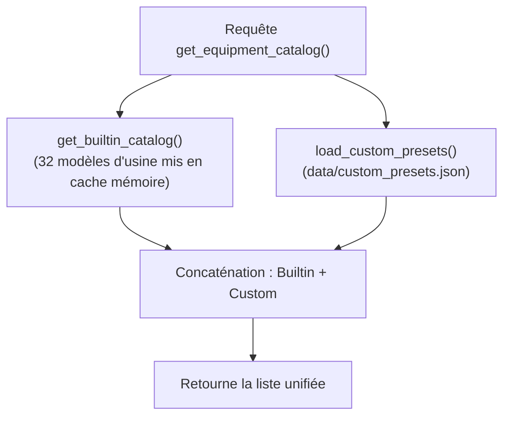

# 🧩 Architecture Développeur : Modèles Personnalisés & Plugin Antigravity

> **Version** : 2.2.0+  
> **Modules** : `app/core/equipment_catalog.py`, `app/api/routes.py`, `customizations/antigravity/plugins/iot-preset-designer/`  
> **Conformité** : Thread-safe `RLock`, PEP 8, Pydantic v2, CIS Docker Benchmark

---

## 1. Architecture de Persistance des Modèles Personnalisés

Les modèles personnalisés sont stockés de manière isolée de l'état runtime de simulation :

- **Chemin du fichier** : `data/custom_presets.json` (configurable par variable d'environnement `CUSTOM_PRESETS_FILE`).
- **Isolation des responsabilités** :
  - `simulator_state.json` : Stocke les équipements instanciés, variables et configuration du broker.
  - `users.json` : Stocke les comptes RBAC et mots de passe hachés en Scrypt.
  - `custom_presets.json` : Stocke exclusivement les modèles métiers personnalisés importés.
- **Concurrence & Thread-Safety** :
  - Les accès d'écriture et de lecture sont protégés par un verrou ré-entrant `threading.RLock()` (`_custom_presets_lock`).
  - L'écriture disque utilise le pattern atomique sécurisé : écriture dans un fichier temporaire `.tmp` puis `os.replace` atomique sous POSIX.
- **Résilience** :
  - Si `data/custom_presets.json` est manquant ou temporairement corrompu, `load_custom_presets()` consigne un avertissement et retourne une liste vide `[]`. L'application démarre et sert toujours l'intégralité des 32 modèles d'usine sans crash.

---

## 2. Cycle de Vie & Protection des Modèles Natifs

### Règles de Protection :
1. **Immuabilité des Modèles d'Usine** :
   - Les 32 modèles natifs restent définis en code Python.
   - `delete_custom_preset()` vérifie si `preset_id` fait partie de `get_builtin_catalog()`. Si oui, une `ValueError` est levée et l'API renvoie HTTP 400.
2. **Anti-Collision à l'Importation** :
   - Si un utilisateur importe un JSON dont l'identifiant entre en conflit avec un modèle d'usine (ex: `ind_compressor`), la fonction `import_preset_data()` renomme automatiquement l'identifiant importé en `ind_compressor_custom` et suffixe le libellé avec `(Personnalisé)`.
3. **Parité Fonctionnelle d'Instanciation** :
   - `instantiate_preset()` et `download_preset_thingsboard_dashboard()` appellent `get_equipment_catalog()`. Tout modèle personnalisé est donc immédiatement instanciable et téléchargeable au format ThingsBoard Dashboard.

---

## 3. Le Plugin Antigravity `iot-preset-designer`

Situé dans `customizations/antigravity/plugins/iot-preset-designer/` et déployé dans `~/.gemini/config/plugins/` :

1. **Manifeste `plugin.json`** : Déclare le plugin selon la spécification Antigravity / Claude Code / Agent Plugins standard.
2. **`AGENTS.md`** : Déclare l'agent IA `IoT Preset Architect` et ses directives métier.
3. **Skill `iot-preset-generator`** :
   - Déclenchée automatiquement sur les intentions de conception de cas d'usage IoT.
   - `references/` : Répertoire de schémas JSON et guides des 12 modes de calcul.
   - `scripts/validate_preset.py` : Script Python autonome d'analyse syntaxique, AST de formules et détection de cycles de dépendances.
   - `scripts/build_full_package.py` : Générateur de packages JSON complets avec ThingsBoard 4.3 SCADA SVG et CSV.
