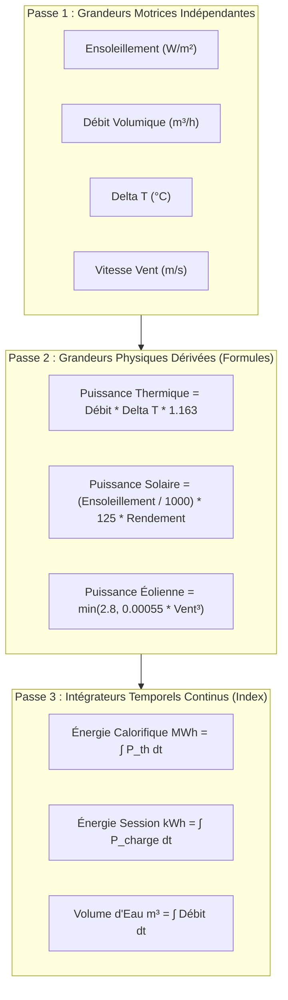

# ⚙️ Moteur de Dépendance Physique & Variables Dérivées

> **Statut** : En production (Version 1.7.0+)  
> **Composants** : [`app/core/physics.py`](file:///home/pierre/Projets/iot-data-simulator/app/core/physics.py), [`app/core/engine.py`](file:///home/pierre/Projets/iot-data-simulator/app/core/engine.py), [`app/models/variable.py`](file:///home/pierre/Projets/iot-data-simulator/app/models/variable.py)

---

## 1. Vue d'Ensemble & Objectif

Dans les environnements industriels et les infrastructures (énergie, génie climatique, automatismes), les grandeurs physiques sont intrinsèquement **interdépendantes et couplées** par des lois thermodynamiques, électriques ou aérauliques. 

Le moteur de dépendance physique de l'IoT Data Simulator garantit une **cohérence causale absolue** entre les grandeurs d'un même équipement. Si une grandeur motrice varie (ou est modifiée manuellement), toutes les grandeurs dérivées et intégrées réagissent instantanément selon les équations physiques configurées.

---

## 2. Les Modes de Simulation Physiques

### Mode `derived` (Formule Physique Dérivée)
Permet de calculer une grandeur en temps réel à partir de la valeur courante d'une ou plusieurs autres variables de l'équipement :
- **Configuration** : `derived_config.formula` (ex: `round(debit_volumique_m3h * delta_t_deg * 1.163, 1)`).
- **Résolution** : Exécutée à chaque tick (toutes les 500 ms) avec le contexte dynamique à jour.
- **Opérateurs autorisés** : `+`, `-`, `*`, `/`, `%`, `**` (puissance).
- **Fonctions mathématiques sécurisées** : `round(x, n)`, `abs(x)`, `min(a, b)`, `max(a, b)`, `sqrt(x)`, `sin(x)`, `cos(x)`, `tan(x)`, `exp(x)`, `log(x)`, `floor(x)`, `ceil(x)`.
- **Conditions ternaires** : `A if Condition else B` (ex: `0 if pompe_arretee else 85.0`).

### Mode `integrator` (Intégrateur Temporel Continu)
Permet de simuler un **index de comptage réel** ou une énergie cumulée continue sans rupture :
$$\text{Index}(t) = \text{Index}(t - \Delta t) + \text{GrandeurSource}(t) \times \frac{\Delta t}{\text{UnitéDiviseur}} \times \text{Multiplicateur}$$
- **Source** : Identifiant de la variable motrice intégrée (ex: puissance en kW).
- **Unités de temps supportées** :
  - `hour` : Diviseur 3600 (ex: intégration de kW en kWh, ou tonnes/h en tonnes).
  - `minute` : Diviseur 60 (ex: intégration de l/min en litres).
  - `second` : Intégration brute par seconde.
- **Multiplicateur d'échelle** : ex: `0.001` pour convertir des kW en MWh.
- **Index initial** : Valeur de départ du compteur (ex: 142.5 MWh).

---

## 3. Sécurité de l'Évaluateur AST (Zéro-Eval)

Pour interdire toute injection de code malveillant ou exécution arbitraire :
1. Aucun appel à `eval()` ou `exec()`.
2. L'expression est analysée via le module standard Python `ast.parse(expression, mode='eval')`.
3. Seuls les nœuds arithmétiques stricts sont autorisés dans l'arbre d'exécution (`ast.BinOp`, `ast.UnaryOp`, `ast.Call`, `ast.IfExp`, `ast.Compare`).
4. Toute division par zéro retourne `0.0` sans générer d'exception ni interrompre le simulateur.
5. Les exposants de puissance sont bornés pour éviter tout déni de service par débordement numérique.

---

## 4. Causalité et Propagation d'Anomalies (*Chaos Cascading*)

L'intégration physique garantit la cohérence en cas de manipulation par l'opérateur :
- **Forçage Manuel** : Si un opérateur déplace le curseur manuel d'une variable motrice (ex: chute d'ensoleillement à 50 W/m² ou débit d'eau à 0 m³/h), la puissance dérivée s'effondre instantanément à l'écran.
- **Anomalie de Gel (*Freeze*)** : Si la température est gelée, les formules aval continuent de calculer avec cette valeur fixe.
- **Arrêt / Coupure (*Zero Production*)** : Si la puissance tombe à zéro, l'intégrateur d'énergie cesse immédiatement de cumuler des kWh.

---

## 5. Exemples Industriels Pré-câblés

| Équipement | Variable Dérivée / Intégrée | Formule / Source | Comportement Réel |
|---|---|---|---|
| **Compteur Thermique** | `puissance_thermique_kw` | `debit_volumique_m3h * delta_t_deg * 1.163` | S'annule si débit = 0 ou $\Delta T = 0$ |
| **Compteur Thermique** | `energie_cumulee_mwh` | $\int \text{puissance\_thermique\_kw} \cdot dt \times 0.001$ | Index MWh qui progresse au rythme de la puissance |
| **Centrale Solaire** | `puissance_injection_kw` | `(ensoleillement / 1000) * 125 * (rendement / 100)` | Suit la course solaire et l'irradiation réelle |
| **Borne IRVE** | `courant_charge_a` | `(puissance_charge_kw * 1000) / (230 * 3)` | Courant calculé selon la loi d'Ohm triphasée |
| **Borne IRVE** | `energie_session_kwh` | $\int \text{puissance\_charge\_kw} \cdot dt$ | Énergie de session facturée proportionnelle aux kW |
| **Aérogénérateur Éolien** | `puissance_active_mw` | `min(2.8, 0.00055 * pow(vitesse_vent_ms, 3))` | Courbe de puissance cubique plafonnée à 2.8 MW |
| **Groupe Froid** | `cop_instantane` | Carnot régulé selon $(T_{depart} + 273.15) / \Delta T$ | Rendement frigorifique thermodynamique |
