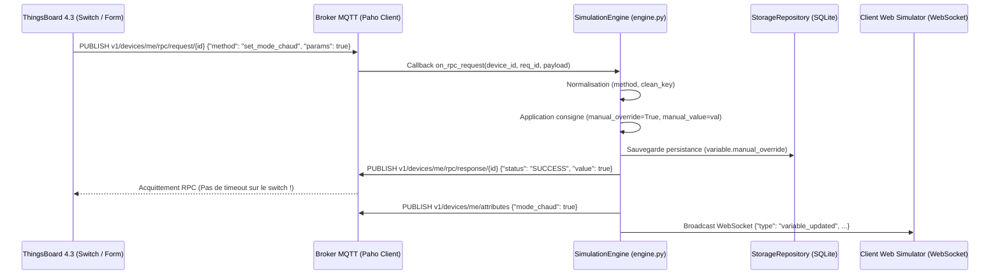

# ⚙️ Moteur de Simulation & Évaluation Mathématique

Ce document détaille l'implémentation du moteur de calcul périodique et l'évaluation mathématique sécurisée.

---

## 🔒 1. Évaluation Mathématique Déterministe (Zéro `eval`)

Pour respecter strictement les recommandations de l'**OWASP** et du **CIS Benchmark**, l'application n'utilise **jamais** de fonction dynamique d'évaluation de chaîne comme `eval()` ou `exec()`, qui exposerait à une exécution de code arbitraire à distance (RCE).

Dans [app/core/generators.py](file:///home/pierre/Projets/iot-data-simulator/app/core/generators.py), chaque forme d'onde est calculée via une fonction mathématique pure :

| Mode | Formule Mathématique | Description |
| :--- | :--- | :--- |
| **Sinus** | $y = \text{mid} + A \cdot \sin(2\pi \cdot \phi) + \text{offset}$ | Onde périodique douce |
| **Cosinus** | $y = \text{mid} + A \cdot \cos(2\pi \cdot \phi) + \text{offset}$ | Déphasage de 90° |
| **Triangle** | Linéaire montant puis descendant | Variation linéaire symétrique |
| **Créneau (Square)** | $y = \text{max}$ si $\phi < 0.5$ sinon $\text{min}$ | Signal binaire / deux états |
| **Dent de Scie** | $y = \text{min} + (\text{max}-\text{min})\cdot \phi$ | Montée constante et reset brutal |
| **Rampe** | $y = \text{min} + \text{pas} \cdot (t / T)$ | Incrément continu |
| **Marche Aléatoire** | $y_{t} = y_{t-1} + \Delta_{\text{random}} \cdot \text{pas}$ | Mouvement brownien borné |
| **Gaussien** | Distribution normale centrée $\mathcal{N}(\mu, \sigma)$ | Bruit blanc statistique |
| **Constante** | $y = \text{valeur fixe}$ | Consigne de régulation |

*Avec :*
* $\text{mid} = \frac{\text{max} + \text{min}}{2}$
* $A = \frac{\text{max} - \text{min}}{2}$ (Amplitude)
* $\phi = \frac{t \pmod T}{T} \in [0, 1[$ (Phase dans la période)

### Superposition du Bruit Réaliste
Si `noise_percent` > 0, un bruit uniforme est additionné :
$$\text{bruit} = (2 \cdot \text{rand}() - 1) \cdot A \cdot \frac{\text{noise\_percent}}{100}$$

---

## 📈 2. Moteur de Rejeu de Séries Temporelles (`ReplayEngine`)

Dans [app/core/replay.py](file:///home/pierre/Projets/iot-data-simulator/app/core/replay.py) :
* Une série temporelle est constituée d'une liste de points ordonnés par leur offset en secondes.
* **Bouclage temporel** : $t_{\text{effectif}} = (t \cdot \text{speed}) \pmod{t_{\text{fin}}}$.
* **Interpolation linéaire** :
  $$\alpha = \frac{t - t_1}{t_2 - t_1}, \quad y = y_1 + \alpha \cdot (y_2 - y_1)$$
* **Import CSV** : Une méthode sécurisée analyse les fichiers texte ou CSV à 2 colonnes (`offset,valeur`) sans dépendances externes lourdes.

---

## 💥 3. Gestionnaire des Défaillances & Anomalies ("Chaos Engine")

Dans [app/core/engine.py](file:///home/pierre/Projets/iot-data-simulator/app/core/engine.py) :
* **Pic (Spike)** : Ajoute instantanément une amplitude exceptionnelle (`anomaly_magnitude`) pendant 3 cycles consécutifs, puis repasse automatiquement à l'état normal.
* **Dérive (Drift)** : Accumule un offset continu à chaque cycle pour simuler un vieillissement ou encrassement de capteur.
* **Gel (Freeze)** : Désactive le calcul et republie indéfiniment la dernière valeur mesurée.
* **Timeout** : Interrompt temporairement l'émission MQTT pour simuler une coupure de réseau ou une panne de batterie.

---

## 🎛️ 4. Boucle d'Interruption & Pilotage Bidirectionnel (RPC & Attributs Partagés)

Dans [`app/core/engine.py`](file:///home/pierre/Projets/iot-data-simulator/app/core/engine.py), le moteur de simulation écoute en continu les commandes descendantes de la plateforme IoT (ThingsBoard 4.3) :

### 4.1 Traitement des Requêtes RPC (`_handle_rpc`)
1. **Normalisation des Méthodes** :
   - `setValue` ou `getValue`
   - `set_<clean_key>` (ex: `set_mode_chaud`, `set_etat_marche`)
   - `toggle_<clean_key>` ou `toggle`
2. **Recherche de la Variable** :
   - Identification par correspondance exacte de clé technique nettoyée (`clean_key`), d'identifiant (`id`) ou de libellé (`name`).
3. **Application & Forçage Déterministe** :
   - Activation du forçage : `variable.manual_override = True`
   - Affectation : `variable.manual_value = new_val` et `variable.current_value = new_val`
   - Conversion typée stricte selon `variable.data_type` (booléen, entier, flottant, chaîne).
4. **Réponse RPC Synchrone & Anti-Timeout** :
   - Publication immédiate sur `v1/devices/me/rpc/response/{req_id}` avec QoS 1 du payload `{"status": "SUCCESS", "value": new_val}`.
   - Cette réponse instantanée garantit que les widgets interactifs de ThingsBoard 4.3 (Round Switch, Toggle Button) valident l'état visuel sans lever d'erreur RPC de délai dépassé.
5. **Confirmation d'Attribut & Broadcast IHM** :
   - Émission du nouvel état sur `v1/devices/me/attributes`.
   - Notification des sessions Web UI ouvertes via `WebSocketManager.broadcast()`.
