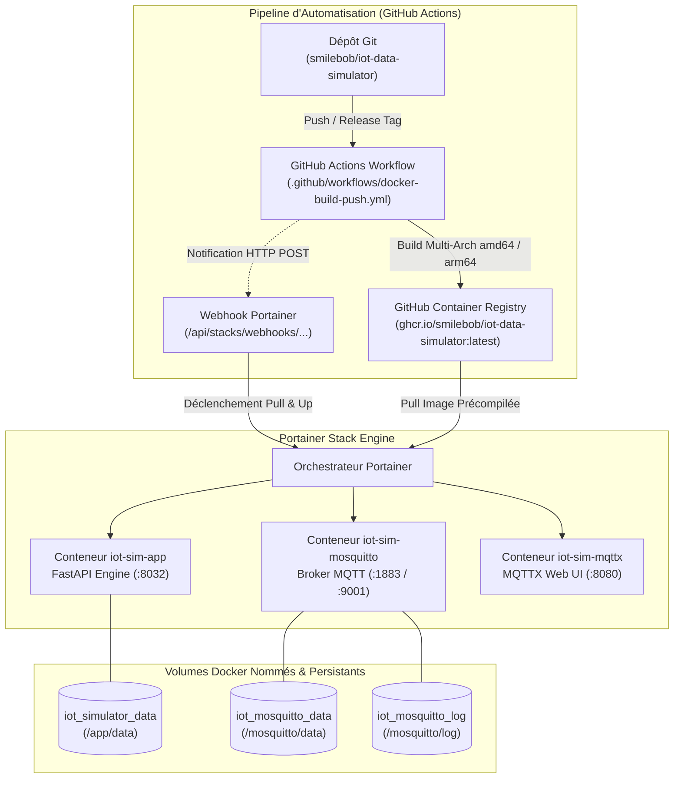
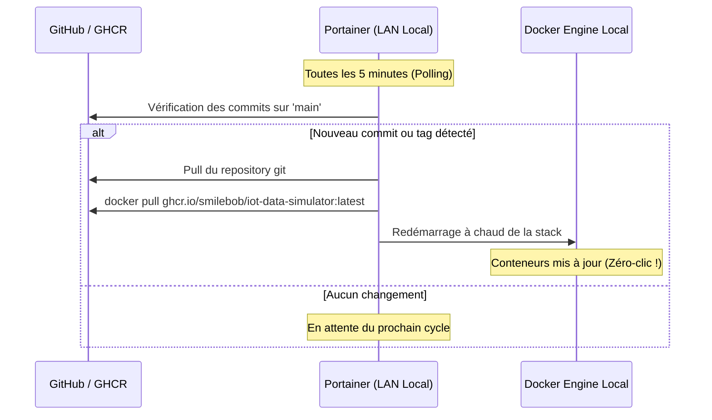

# 🚢 Guide de Déploiement Portainer & Automatisation CI/CD Pas-à-Pas

> **Compatibilité** : Portainer Community Edition (CE) et Business Edition (BE) v2.16+  
> **Image Conteneur** : `ghcr.io/smilebob/iot-data-simulator:latest` (Multi-Arch `linux/amd64` et `linux/arm64`)  
> **Type de Déploiement** : Portainer Stack (Docker Compose v2)  
> **Conformité de Sécurité** : CIS Docker Benchmark (UID 10001 non-root, `cap_drop: [ALL]`, `no-new-privileges: true`)

---

## 1. Vue d'Ensemble & Architecture de la Stack

La stack **IoT Data Simulator** est une architecture conteneurisée industrielle complète intégrant le moteur de simulation, le broker MQTT Eclipse Mosquitto durci, et un inspecteur graphique de trames MQTT.



### Services déployés et ports d'écoute

| Conteneur | Service | Port Hôte par défaut | Rôle & Fonctionnalités |
| :--- | :--- | :---: | :--- |
| `iot-sim-app` | **Simulateur Web & API** | `8032` | Interface utilisateur, API REST, WebSocket, moteur de simulation et calculs télémétriques. |
| `iot-sim-mosquitto` | **Broker MQTT Mosquitto** | `1883` | Ingestion et distribution télémétrique MQTT (TCP standard). |
| `iot-sim-mosquitto` | **Mosquitto WebSockets** | `9001` | Flux MQTT via WebSockets pour synoptiques et dashboards web en direct. |
| `iot-sim-mqttx` | **MQTTX Web Inspector** | `8080` | Interface web d'inspection, abonnement et publication interactive des payloads MQTT. |

---

## 2. Prérequis & Vérifications Préliminaires

Avant de commencer le déploiement dans Portainer, assurez-vous de disposer des éléments suivants :

1. **Instance Portainer active** : Portainer CE ou BE version 2.16 ou supérieure installée sur votre serveur (Linux, Raspberry Pi 4/5, machine virtuelle ou Cloud).
2. **Ports réseau disponibles** : Vérifiez que les ports `8032`, `1883`, `9001` et `8080` ne sont pas déjà occupés sur la machine hôte. *(Le port hôte `8032` est configuré par défaut pour éviter tout conflit avec l'agent Portainer Edge qui occupe traditionnellement le port `8000`)*.
3. **Accès réseau sortant** : Le serveur hébergeant Portainer doit pouvoir joindre :
   - `ghcr.io` et `pkg-containers.githubusercontent.com` (téléchargement de l'image de simulation).
   - `docker.io` / Docker Hub (téléchargement de Mosquitto et MQTTX).
   - `github.com` (en cas de déploiement direct via le dépôt Git).

---

## 3. Méthode 1 : Déploiement par Dépôt Git & Auto-Update Webhook (Recommandé)

Cette méthode est la solution recommandée pour un environnement de démonstration ou de production : Portainer clone le dépôt officiel et peut mettre à jour automatiquement la stack à chaque nouveau commit ou release.

### Étape 1.1 : Naviguer vers l'écran d'ajout de Stack

1. Ouvrez votre navigateur et connectez-vous à votre interface **Portainer**.
2. Dans le menu de gauche, sélectionnez votre environnement Docker (généralement nommé **`local`** ou le nom de votre serveur).
3. Cliquez sur l'onglet **`Stacks`** dans le menu latéral.
4. Cliquez sur le bouton bleu **`+ Add stack`** situé en haut à droite.

```
+-----------------------------------------------------------------------------------+
| Portainer [local] > Stacks > + Add stack                                          |
+-----------------------------------------------------------------------------------+
| Name: [ iot-simulator                                                           ] |
|                                                                                   |
| Build method:                                                                     |
| ( ) Web editor    (o) Repository    ( ) Upload    ( ) Custom template             |
+-----------------------------------------------------------------------------------+
```

### Étape 1.2 : Renseigner le Formulaire de Dépôt Git

Remplissez les champs exactement comme indiqué ci-dessous :

| Champ dans Portainer | Valeur à renseigner | Description / Précision |
| :--- | :--- | :--- |
| **Name** | `iot-simulator` | Nom unique identifiant votre stack dans Portainer. |
| **Build method** | Cocher **`Repository`** | Déploiement automatisé basé sur Git. |
| **Repository URL** | `https://github.com/smilebob/iot-data-simulator.git` | Dépôt public officiel du projet. |
| **Repository reference** | `refs/heads/main` | Branche principale (ou un tag spécifique ex: `refs/tags/v1.0.0`). |
| **Compose path** | `docker-compose.portainer.yml` | **Important** : Spécifier le fichier compose dédié à Portainer. |
| **Authentication** | Laisser **Désactivé** (Off) | Le dépôt public ne nécessite aucun identifiant. |

### Étape 1.3 : Configurer la Mise à Jour Automatique (Auto-Update Webhook)

Pour que Portainer mette à jour vos conteneurs automatiquement dès qu'une nouvelle version de l'image Docker est compilée par GitHub Actions :

1. Dans la section **Automatic updates**, basculez l'interrupteur sur **`ON`**.
2. Sélectionnez le mécanisme **`Webhook`**.
3. Portainer génère immédiatement une URL sécurisée avec un jeton UUID unique, par exemple :
   ```
   https://portainer.votre-domaine.fr/api/stacks/webhooks/d0f2a71e-45b1-4f12-a723-8c76391d84f1
   ```
4. Cliquez sur le bouton de copie pour sauvegarder cette URL (nous l'utiliserons à la section 4).

*(Alternative : si votre Portainer n'est pas exposé sur Internet et ne peut pas recevoir d'appels entrants de GitHub, sélectionnez **`Polling`** et définissez un intervalle comme `5m` pour vérifier les mises à jour toutes les 5 minutes).*

### Étape 1.4 : Ajuster les Variables d'Environnement (Optionnel)

Faites défiler jusqu'à la section **Environment variables**. Si vous souhaitez modifier les ports hôtes ou la configuration MQTT par défaut, cliquez sur **`+ Add environment variable`** pour ajouter des paires clé/valeur :

| Nom de Variable (Key) | Valeur par défaut | Description |
| :--- | :---: | :--- |
| `SIMULATOR_PORT` | `8032` | Port HTTP de l'interface web du simulateur sur votre hôte. |
| `MQTT_BROKER_HOST` | `mosquitto` | Nom d'hôte du broker (le conteneur Mosquitto dans le réseau Docker interne). |
| `MQTT_BROKER_PORT` | `1883` | Port interne du broker MQTT. |
| `MQTT_USE_TLS` | `false` | Activer le chiffrement TLS pour le broker distant si applicable. |

### Étape 1.5 : Déclencher le Déploiement

1. Cliquez sur le bouton bleu **`Deploy the stack`** en bas de la page.
2. Portainer clone le dépôt, télécharge l'image précompilée `ghcr.io/smilebob/iot-data-simulator:latest`, crée les volumes nommés et lance les 3 conteneurs.
3. Un message de confirmation vert apparaît : *Stack successfully deployed*.

---

## 4. Configuration CI/CD : Déclencher l'Auto-Déploiement depuis GitHub Actions (Portainer Public)

Le workflow GitHub Actions situé dans [`.github/workflows/docker-build-push.yml`](file:///home/pierre/Projets/iot-data-simulator/.github/workflows/docker-build-push.yml) est préconfiguré pour notifier Portainer via Webhook dès qu'une nouvelle image multi-architecture (`linux/amd64` et `linux/arm64`) est publiée sur GHCR.

> [!NOTE]
> Cette méthode s'applique si votre Portainer possède un nom de domaine public ou un tunnel (ex: Cloudflare Tunnel, Tailscale Funnel) lui permettant de recevoir des requêtes POST de GitHub Actions. Si votre Portainer est situé sur un **réseau local privé non exposé**, consultez directement la [Section 4.1 ci-dessous](#41-automatisation-sur-réseau-local-privé-sans-ip-publique).

Pour activer cette liaison :

1. Ouvrez votre dépôt GitHub dans votre navigateur :  
   `https://github.com/smilebob/iot-data-simulator`
2. Rendez-vous dans **`Settings`** (onglet en haut à droite du dépôt).
3. Dans la barre latérale gauche, développez **`Secrets and variables`** puis cliquez sur **`Actions`**.
4. Cliquez sur le bouton vert **`New repository secret`**.
5. Renseignez les champs :
   - **Name** : `PORTAINER_WEBHOOK_URL`
   - **Secret** : Collez l'URL de webhook générée par Portainer à l'étape 1.3.
6. Cliquez sur **`Add secret`**.

Désormais, à chaque commit poussé sur la branche `main` ou à chaque tag de version créé, le workflow GitHub Actions :
- Exécute les tests unitaires.
- Compile les binaires Docker pour architectures x86_64 et ARM64.
- Pousse l'image sur GitHub Container Registry.
- Envoie une requête HTTP POST au webhook Portainer pour rafraîchir automatiquement vos conteneurs sans aucune intervention manuelle.

---

## 4.1 Automatisation sur Réseau Local Privé (Sans Exposition Publique)

Lorsque votre serveur Portainer est situé sur un **réseau local privé (LAN, box internet, NAS, homelab Proxmox)** ayant un accès sortant à Internet mais sans port exposé au monde extérieur, GitHub ne peut pas appeler directement votre webhook Portainer.

Deux solutions éprouvées et sécurisées s'offrent à vous :

### Solution A : Le Mode Polling GitOps Natif de Portainer (100% Automatique & Recommandé)

Dans ce mode, c'est **Portainer lui-même** qui prend l'initiative de vérifier périodiquement sur GitHub (via sa connexion Internet sortante) si une nouvelle version est disponible.

1. Dans Portainer, accédez à votre stack **`iot-simulator`**.
2. Allez dans l'onglet **`Editor`**.
3. Dans la section **Automatic updates** :
   - Interrupteur activé sur **`ON`**.
   - Cochez le mode **`Polling`**.
   - Définissez l'intervalle d'interrogation, par exemple **`5m`** (toutes les 5 minutes).
4. *(Recommandé)* Cochez l'option **`Re-pull image`** afin que Portainer télécharge systématiquement la dernière image GHCR associée (`ghcr.io/smilebob/iot-data-simulator:latest`).
5. Cliquez sur **`Update the stack`**.



---

### Solution B : Déploiement en 1 Ligne de Commande via le Script CLI (`scripts/portainer_deploy.py`)

Si vous souhaitez déclencher immédiatement le redéploiement depuis votre machine de travail connectée au même réseau local (sans attendre le cycle de polling de 5 minutes), un script Python dédié est fourni dans le dépôt.

#### 1. Configuration initiale (Fichier local `.env.portainer`)
Copiez le modèle [`/.env.portainer.example`](file:///home/pierre/Projets/iot-data-simulator/.env.portainer.example) vers `.env.portainer` :
```bash
cp .env.portainer.example .env.portainer
```

Renseignez l'une des deux options :
- **Via le Webhook local** (le plus rapide) :
  ```env
  PORTAINER_WEBHOOK_URL=http://192.168.1.50:9000/api/stacks/webhooks/d0f2a71e-45b1-4f12-a723-8c76391d84f1
  ```
- **Ou via l'API REST Portainer avec clé d'API** :
  ```env
  PORTAINER_URL=http://192.168.1.50:9000
  PORTAINER_API_KEY=ptr_votre_cle_api
  PORTAINER_STACK_NAME=iot-simulator
  ```
  *(Pour générer votre clé d'API dans Portainer : cliquez sur votre nom en haut à droite > **`My account`** > section **`Access tokens`** > **`+ Add access token`**)*.

#### 2. Déclencher le déploiement instantané
Depuis la racine du projet, lancez simplement :
```bash
python3 scripts/portainer_deploy.py
```

Le script :
- Se connecte à votre Portainer local.
- Déclenche le redéploiement de la stack.
- Force le pull de l'image fraîche sur GitHub Container Registry.
- Confirme la validation et le redémarrage des conteneurs.

---

## 5. Méthode 2 : Déploiement par l'Éditeur Web Portainer (Web Editor)

Si vous préférez déployer la stack immédiatement sans lier de dépôt Git :

1. Connectez-vous à **Portainer** > Environnement (ex: `local`) > **`Stacks`** > **`+ Add stack`**.
2. Nom de la stack : `iot-simulator`.
3. Laissez sélectionné le mode par défaut : **`Web editor`**.
4. Copiez l'intégralité du contenu du fichier [`docker-compose.portainer.yml`](file:///home/pierre/Projets/iot-data-simulator/docker-compose.portainer.yml) ci-dessous et collez-le dans la zone de texte :

```yaml
version: "3.8"

services:
  # -------------------------------------------------------------
  # 1. Broker MQTT Eclipse Mosquitto
  # -------------------------------------------------------------
  mosquitto:
    image: eclipse-mosquitto:2
    container_name: iot-sim-mosquitto
    restart: unless-stopped
    ports:
      - "1883:1883"
      - "9001:9001"
    volumes:
      - mosquitto_data:/mosquitto/data
      - mosquitto_log:/mosquitto/log
    security_opt:
      - "no-new-privileges:true"
    healthcheck:
      test: ["CMD-SHELL", "timeout 2 nc -z localhost 1883 || exit 1"]
      interval: 10s
      timeout: 3s
      retries: 3
    networks:
      - iot-network

  # -------------------------------------------------------------
  # 2. IoT Data Simulator (Application FastAPI & Simulation)
  # -------------------------------------------------------------
  simulator:
    image: ghcr.io/smilebob/iot-data-simulator:latest
    container_name: iot-sim-app
    restart: unless-stopped
    ports:
      - "${SIMULATOR_PORT:-8032}:8000"
    environment:
      - MQTT_BROKER_HOST=${MQTT_BROKER_HOST:-mosquitto}
      - MQTT_BROKER_PORT=${MQTT_BROKER_PORT:-1883}
      - MQTT_USE_TLS=${MQTT_USE_TLS:-false}
      - MQTT_USERNAME=${MQTT_USERNAME:-}
      - MQTT_PASSWORD=${MQTT_PASSWORD:-}
    volumes:
      - simulator_data:/app/data
    depends_on:
      mosquitto:
        condition: service_healthy
    security_opt:
      - "no-new-privileges:true"
    cap_drop:
      - ALL
    healthcheck:
      test: ["CMD", "curl", "-f", "http://localhost:8000/healthz"]
      interval: 15s
      timeout: 5s
      retries: 3
      start_period: 10s
    networks:
      - iot-network

  # -------------------------------------------------------------
  # 3. Client Web MQTTX (Inspection & Diagnostic Télémétrique)
  # -------------------------------------------------------------
  mqtt-web:
    image: emqx/mqttx-web:latest
    container_name: iot-sim-mqttx
    restart: unless-stopped
    ports:
      - "8080:80"
    security_opt:
      - "no-new-privileges:true"
    networks:
      - iot-network

volumes:
  simulator_data:
    name: iot_simulator_data
  mosquitto_data:
    name: iot_mosquitto_data
  mosquitto_log:
    name: iot_mosquitto_log

networks:
  iot-network:
    name: iot-simulator-net
    driver: bridge
```

5. Cliquez sur le bouton **`Deploy the stack`**.

---

## 6. Méthode 3 : Déploiement via Portainer App Templates (Catalogue 1-Clic)

Le projet met à disposition un modèle d'application officiel Portainer situé dans [`templates/portainer-template.json`](file:///home/pierre/Projets/iot-data-simulator/templates/portainer-template.json).

Pour l'intégrer à votre catalogue Portainer :

1. Dans Portainer, cliquez sur **`Settings`** dans la barre latérale gauche.
2. Dans la section **App Templates**, activez ou complétez le champ **`URL`** avec l'adresse du fichier brut :
   ```
   https://raw.githubusercontent.com/smilebob/iot-data-simulator/main/templates/portainer-template.json
   ```
3. Cliquez sur **`Save settings`**.
4. Rendez-vous dans votre environnement > **`App Templates`**.
5. Cliquez sur la carte **`IoT Data Simulator & MQTT Stack`**.
6. Ajustez le port ou le broker si nécessaire, puis cliquez sur **`Deploy the stack`**.

---

## 7. Vérification Post-Déploiement & Première Connexion

Une fois la stack déployée, suivez ces vérifications pour vous assurer de son bon fonctionnement :

### Étape 7.1 : Vérifier l'État des Conteneurs dans Portainer

1. Allez dans **`Stacks`** > cliquez sur **`iot-simulator`**.
2. Dans la liste des conteneurs, vérifiez les indicateurs d'état :
   - `iot-sim-mosquitto` : Doit être **`healthy`** (en vert).
   - `iot-sim-app` : Doit être **`healthy`** (en vert).
   - `iot-sim-mqttx` : Doit être **`running`** (en vert).

```
+-----------------------------------------------------------------------------------+
| Container Name         | Image                               | State   | Health   |
+------------------------+-------------------------------------+---------+----------+
| iot-sim-mosquitto      | eclipse-mosquitto:2                 | running | healthy  |
| iot-sim-app            | ghcr.io/smilebob/iot-data-simulator | running | healthy  |
| iot-sim-mqttx          | emqx/mqttx-web:latest               | running | -        |
+------------------------+-------------------------------------+---------+----------+
```

### Étape 7.2 : Consulter les Logs Applicatifs

1. Cliquez sur l'icône de logs 📄 en face du conteneur `iot-sim-app`.
2. Vous devez constater les messages de démarrage d'Uvicorn :
   ```text
   INFO:     Started server process [1]
   INFO:     Waiting for application startup.
   INFO:     Application startup complete.
   INFO:     Uvicorn running on http://0.0.0.0:8000 (Press CTRL+C to quit)
   ```

### Étape 7.3 : Tester la Sonde de Santé

Depuis votre terminal ou votre navigateur :
```bash
curl -I http://<IP_DE_VOTRE_SERVEUR>:8032/healthz
```
Réponse attendue :
```http
HTTP/1.1 200 OK
content-type: application/json
```

### Étape 7.4 : Accéder à l'Interface et Première Connexion

1. Ouvrez votre navigateur sur `http://<IP_DE_VOTRE_SERVEUR>:8032`.
2. Connectez-vous avec les identifiants d'initialisation par défaut :
   - **Identifiant** : `admin`
   - **Mot de passe initial** : `Admin_123456!`
3. **Recommandation de sécurité immédiate** : Rendez-vous dans l'onglet **Gestion des Utilisateurs** pour modifier le mot de passe du compte administrateur.

---

## 8. Guide de Résolution des Incidents (Troubleshooting & FAQ)

### Problème 1 : Conflit de Port hôte (`bind: address already in use`)

- **Symptôme** : Le conteneur refuse de démarrer avec l'erreur `driver failed programming external connectivity on endpoint ... bind: address already in use`.
- **Cause** : Un service existant sur la machine hôte écoute déjà sur le port `8032` (ex: autre service) ou `1883` (autre broker MQTT).
- **Résolution dans Portainer** :
  1. Ouvrez la stack **`iot-simulator`**.
  2. Allez dans l'onglet **`Editor`** ou **`Environment variables`**.
  3. Modifiez la variable `SIMULATOR_PORT` (par exemple `SIMULATOR_PORT=8085`).
  4. Si c'est le port 1883 qui est en conflit, remplacez dans le compose `1883:1883` par `11883:1883`.
  5. Cliquez sur **`Update the stack`**.

---

### Problème 2 : Échec du Webhook Portainer (Erreur 404 ou Timeout)

- **Symptôme** : GitHub Actions affiche une erreur lors de l'appel du webhook Portainer.
- **Cause** : L'URL du webhook utilise une adresse IP privée (`192.168.x.x` ou `localhost`) inaccessible depuis les serveurs de GitHub Actions, ou le pare-feu bloque le port Portainer (`9443` ou `9000`).
- **Résolution** :
  1. Si votre serveur Portainer possède un nom de domaine public avec certificat SSL (ex: `https://portainer.votre-domaine.fr`), assurez-vous que l'URL du webhook utilise ce domaine.
  2. Si Portainer est sur un réseau local privé sans IP publique, n'utilisez pas le Webhook GitHub Actions. Choisissez l'option **`Polling`** (intervalle de 5 à 15 minutes) dans la configuration de la Stack Portainer : Portainer interrogera lui-même GitHub pour détecter les nouvelles images.

---

### Problème 3 : Erreur de Clônage Git (`Authentication failed`)

- **Symptôme** : Portainer n'arrive pas à cloner le dépôt Git.
- **Cause** : Si vous avez forké le dépôt vers une organisation ou un dépôt privé GitHub.
- **Résolution** :
  1. Dans Portainer, lors de la création ou modification de la stack, cochez l'option **`Authentication`**.
  2. Renseignez votre nom d'utilisateur GitHub.
  3. Dans le champ mot de passe, collez un **GitHub Personal Access Token (PAT)** avec le droit de lecture `repo` (et non votre mot de passe de compte GitHub).

---

### Problème 4 : Sauvegarde et Restauration des Données

- **Emplacement des données** : Toutes les données de configuration (équipements virtuels, variables, scénarios, comptes utilisateurs) sont stockées dans le volume persistant `iot_simulator_data`.
- **Inspection dans Portainer** :
  1. Allez dans **`Volumes`** dans le menu latéral Portainer.
  2. Cliquez sur **`iot_simulator_data`**.
  3. Vous pouvez visualiser le chemin physique sur le disque hôte (ex: `/var/lib/docker/volumes/iot_simulator_data/_data`).
- **Sauvegarde simple en ligne de commande** :
  ```bash
  docker run --rm -v iot_simulator_data:/data -v $(pwd):/backup alpine tar czf /backup/iot_simulator_backup.tar.gz -C /data .
  ```
- **Restauration** :
  ```bash
  docker run --rm -v iot_simulator_data:/data -v $(pwd):/backup alpine tar xzf /backup/iot_simulator_backup.tar.gz -C /data
  ```

---

## 9. Synthèse des Bonnes Pratiques de Production

1. **Ne pas exposer le port 1883 Mosquitto publiquement sans authentification** : Si votre serveur possède une adresse IP publique, filtrez l'accès au port 1883 via votre pare-feu (UFW / Security Group) pour n'autoriser que vos équipements IoT ou utilisez une connexion chiffrée MQTTS (voir [Guide de Durcissement Mosquitto](mosquitto_hardening.md)).
2. **Utiliser un Reverse Proxy HTTPS pour l'interface Web** : Pour la production, placez Traefik, Nginx Proxy Manager ou Caddy devant le port 8032 pour bénéficier d'un certificat SSL Let's Encrypt automatique (voir [Guide Reverse Proxy](remote_deployment.md)).
3. **Mettre à jour régulièrement** : Grâce à l'image GHCR multi-arch et au webhook Portainer, vos déploiements restent sécurisés et à jour en continu.