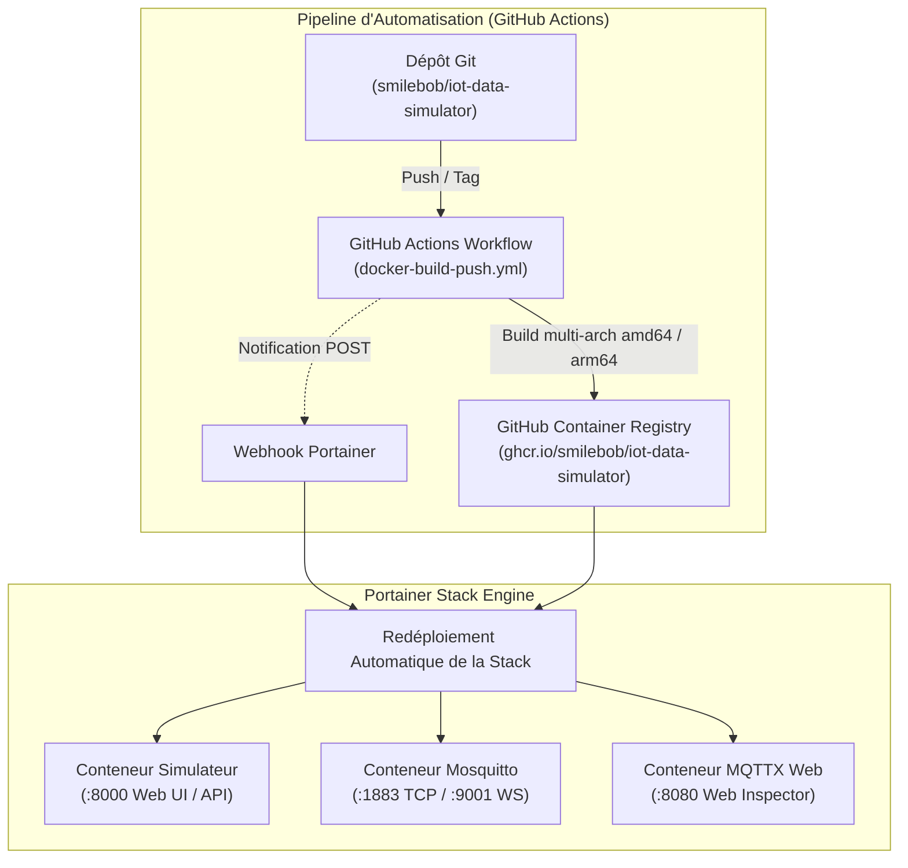

# 🚢 Guide de Déploiement Portainer & Automatisation CI/CD

> **Compatibilité** : Portainer Community Edition (CE) et Business Edition (BE) v2.x+  
> **Image Conteneur** : `ghcr.io/smilebob/iot-data-simulator:latest` (Multi-Arch `linux/amd64` et `linux/arm64`)  
> **Type de Déploiement** : Portainer Stack (Docker Compose v2)  

---

## 1. Vue d'Ensemble de l'Architecture

La stack **IoT Data Simulator** est entièrement conteneurisée et prête pour un déploiement clé en main sur **Portainer** (serveur dédié, VM Linux, Raspberry Pi 4/5, cluster Docker Swarm ou Cloud VPS).



---

## 2. Méthode 1 : Déploiement par Dépôt Git & Auto-Update Webhook (Recommandé)

Cette méthode est la plus élégante et automatisée : Portainer surveille le dépôt GitHub et redéploie automatiquement la stack dès qu'une nouvelle version de l'image est publiée.

### Étape 1 : Créer la Stack dans Portainer
1. Connectez-vous à votre interface **Portainer**.
2. Dans le menu de votre environnement (ex: `local`), cliquez sur **Stacks** puis sur le bouton **`+ Add stack`**.
3. Renseignez le nom de la stack : `iot-simulator`.
4. Sélectionnez le mode **`Repository`**.
5. Remplissez les champs de configuration Git :
   - **Repository URL** : `https://github.com/smilebob/iot-data-simulator.git`
   - **Repository reference** : `refs/heads/main`
   - **Compose path** : `docker-compose.portainer.yml`
6. *(Optionnel)* Activez **Automatic updates** :
   - Choisissez **Webhook** : Portainer génère une URL unique du type :
     `https://portainer.votre-domaine.fr/api/stacks/webhooks/d0f2a71e-xxxx-xxxx-xxxx-xxxxxxxxxxxx`
   - Copiez cette URL.

### Étape 2 : Connecter le Webhook à GitHub Actions (Optionnel pour CI/CD continue)
1. Rendez-vous sur votre dépôt GitHub : `https://github.com/smilebob/iot-data-simulator/settings/secrets/actions`.
2. Cliquez sur **New repository secret**.
3. Nommez le secret : `PORTAINER_WEBHOOK_URL`.
4. Collez l'URL de Webhook fournie par Portainer.
5. À chaque `push` sur la branche `main`, GitHub Actions compile l'image multi-architecture, la pousse sur GHCR, et déclenche instantanément le Webhook Portainer pour mettre à jour vos conteneurs !

### Étape 3 : Déployer
Cliquez sur le bouton **`Deploy the stack`**. En quelques secondes, Portainer télécharge l'image précompilée et lance les 3 services.

---

## 3. Méthode 2 : Déploiement par l'Éditeur Web Portainer (Copier-Coller Immédiat)

Si vous ne souhaitez pas lier de dépôt Git à Portainer :

1. Dans Portainer, allez dans **Stacks** > **`+ Add stack`**.
2. Nommez la stack : `iot-simulator`.
3. Laissez le sélecteur sur **`Web editor`**.
4. Copiez et collez l'intégralité du fichier [`docker-compose.portainer.yml`](file:///home/pierre/Projets/iot-data-simulator/docker-compose.portainer.yml) :

```yaml
services:
  mosquitto:
    image: eclipse-mosquitto:2
    container_name: iot-sim-mosquitto
    restart: unless-stopped
    ports:
      - "1883:1883"
      - "9001:9001"
    volumes:
      - mosquitto_data:/mosquitto/data
      - mosquitto_log:/mosquitto/log
    security_opt:
      - "no-new-privileges:true"
    healthcheck:
      test: ["CMD-SHELL", "timeout 2 nc -z localhost 1883 || exit 1"]
      interval: 10s
      timeout: 3s
      retries: 3
    networks:
      - iot-network

  simulator:
    image: ghcr.io/smilebob/iot-data-simulator:latest
    container_name: iot-sim-app
    restart: unless-stopped
    ports:
      - "8000:8000"
    environment:
      - MQTT_BROKER_HOST=mosquitto
      - MQTT_BROKER_PORT=1883
      - MQTT_USE_TLS=false
      - MQTT_USERNAME=
      - MQTT_PASSWORD=
    volumes:
      - simulator_data:/app/data
    depends_on:
      mosquitto:
        condition: service_healthy
    security_opt:
      - "no-new-privileges:true"
    cap_drop:
      - ALL
    networks:
      - iot-network

  mqtt-web:
    image: emqx/mqttx-web:latest
    container_name: iot-sim-mqttx
    restart: unless-stopped
    ports:
      - "8080:80"
    security_opt:
      - "no-new-privileges:true"
    networks:
      - iot-network

volumes:
  simulator_data:
    name: iot_simulator_data
  mosquitto_data:
    name: iot_mosquitto_data
  mosquitto_log:
    name: iot_mosquitto_log

networks:
  iot-network:
    name: iot-simulator-net
    driver: bridge
```

5. Cliquez sur **`Deploy the stack`**.

---

## 4. Accès aux Services une fois Déployés

| Service | Port | Rôle & Usage | Identifiants par défaut |
| :--- | :---: | :--- | :--- |
| **Simulateur Web GUI** | `8000` | Interface de pilotage des simulations, scénarios et dashboards | `admin` / `Admin_123456!` (invitation au changement) |
| **Broker Mosquitto TCP** | `1883` | Ingestion et distribution télémétrique MQTT | Anonyme ou configuré dans Mosquitto |
| **Mosquitto WebSockets** | `9001` | Flux MQTT temps réel pour dashboards web distants | Port standard WS |
| **MQTTX Web Inspector** | `8080` | Client d'inspection visuelle des trames MQTT émises en direct | Accessible sans mot de passe |

---

## 5. Gestion des Volumes & Conformité CIS Benchmark

- **Sécurité CIS (Utilisateur non-root)** : Le conteneur s'exécute avec l'utilisateur non privilégié `UID 10001` (`appuser`) et `cap_drop: [ALL]`.
- **Persistance automatique** : Les volumes nommés `iot_simulator_data` et `iot_mosquitto_data` sont créés automatiquement par Portainer et protégés contre toute suppression accidentelle lors du redémarrage de la stack.
- **Sauvegarde et Restauration** : Les configurations d'équipements et scénarios sont consignés dans `simulator_data/simulator_state.json` et les utilisateurs dans `simulator_data/users.json` (permissions `0600`).
