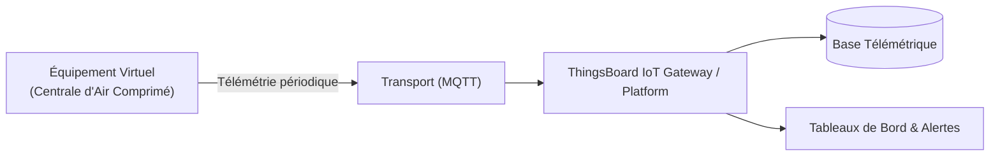

# Cas d'Usage Métier : Centrale d'Air Comprimé

> **Secteur d'Activité** : Industrie & Automatismes  
> **Identifiant du Modèle** : `ind_compressor`  
> **Protocole Recommandé** : `MQTT` | **Plateforme Cible** : ThingsBoard, Multi-Plateformes  
> **Icône Applicative** : `gauge`

---

## 1. Contexte & Enjeux Métier

Fourniture continue d'air comprimé pour les outillages pneumatiques, vérins et machines de production en milieu industriel. L'enjeu est l'efficacité énergétique, le maintien de pression sans perte de charge et la maintenance prédictive de la vis.

### Objectifs Opérationnels :
- Acquisition en temps réel des grandeurs physiques critiques sans latence.
- Surveillance continue et détection précoce des dérives ou pannes potentielles.
- Optimisation des consommations d'énergie et réduction des coûts d'exploitation et de maintenance.
- Traçabilité réglementaire et conformité aux standards de sécurité industrielle.

---

## 2. Architecture & Topologie de Communication

L'équipement virtuel `ind_compressor` s'interface directement avec ThingsBoard ou un broker intermédiaire selon les modalités suivantes :



- **Transport standard** : `MQTT`
- **Topic MQTT / Endpoint HTTP / CoAP** :
  - **MQTT** : `v1/devices/me/telemetry` (télémétrie) et `v1/devices/me/attributes` (attributs)
  - **HTTP** : `POST /api/v1/{token}/telemetry`
  - **CoAP** : `coap://thingsboard:5683/api/v1/{token}/telemetry`

---

## 3. Dictionnaire Détaillé des Variables

| Clé (ID) | Grandeur Lisible | Type | Format | Unité | Période | Générateur / Plage | Rôle Métier & Description |
|---|---|---|---|---|---|---|---|
| `pression_reseau` | **Pression Réseau** | `telemetry` | `float` | `bar` | 2.0s | Dent de scie [6.2, 8.5] bar | Pression délivrée dans le circuit général avec cycles de charge/décharge |
| `temp_vis_huile` | **Température Huile / Vis** | `telemetry` | `float` | `°C` | 5.0s | Sinusoïde [68, 82] °C | Température de palier et de l'huile de lubrification |
| `debit_air` | **Débit Massique** | `telemetry` | `float` | `Nm³/h` | 3.0s | Marche aléatoire [120, 450] Nm³/h | Consommation instantanée d'air par l'atelier |
| `puissance_active` | **Puissance Électrique Active** | `telemetry` | `float` | `kW` | 2.0s | Sinusoïde [22, 75] kW | Appel de puissance sur le compresseur triphasé |
| `etat_marche` | **État de Fonctionnement** | `attribute` | `boolean` | `-` | 30.0s | Constante (True) | Indicateur marche/arrêt de l'équipement |

---

## 4. Schémas des Payloads JSON (ThingsBoard)

### 4.1 Télémétrie Périodique
```json
{
  "pression_reseau": 24.5,
  "temp_vis_huile": 24.5,
  "debit_air": 24.5,
  "puissance_active": 24.5
}
```

### 4.2 Attributs d'État Partagés & Client
```json
{
  "etat_marche": false
}
```

---

## 5. Scénarios d'Anomalies & Maintenance Prédictive

Le moteur du simulateur permet d'injecter des défaillances en direct (*Chaos Testing*) pour éprouver les règles d'alertes du serveur :

- **Pic ponctuel anormal (*Spike*)** : Simule un à-coup de pression, un choc mécanique ou une surtension transitoire.
- **Dérive continue (*Drift*)** : Simule l'encrassement progressif, le manque de lubrification ou une fuite d'étanchéité graduelle.
- **Gel de valeur (*Freeze*)** : Simule un blocage mécanique de capteur ou un convertisseur bloqué.
- **Silence radio (*Timeout*)** : Simule une perte d'alimentation du module ou une rupture de liaison télécoms.

> [!WARNING]
> **Cas de défaillance type** :  
> Échauffement anormal de l'huile de lubrification (>85°C), chute brutale de pression liée à une fuite sur collecteur, colmatage filtre.

---

## 6. Recommandations de Visualisation & Tableaux de Bord

Pour restituer la valeur métier de cet équipement sur ThingsBoard, les widgets suivants sont conseillés :

- Jauge circulaire de pression réseau
- Graphique temporel puissance vs débit
- Alerte seuil température huile > 80°C
