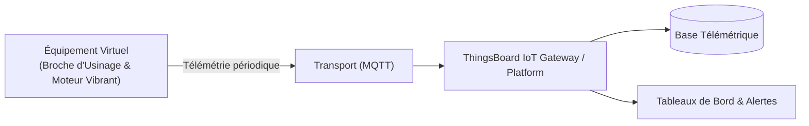

# Cas d'Usage Métier : Broche d'Usinage & Moteur Vibrant

> **Secteur d'Activité** : Industrie & Automatismes  
> **Identifiant du Modèle** : `ind_spindle`  
> **Protocole Recommandé** : `MQTT` | **Plateforme Cible** : ThingsBoard, Multi-Plateformes  
> **Icône Applicative** : `cog`

---

## 1. Contexte & Enjeux Métier

Usinage grande vitesse (UGV) et machines-outils CNC. Analyse vibratoire et thermique haute fréquence pour détecter les défauts d'écaillage de roulement ou balourd bien avant la casse machine.

### Objectifs Opérationnels :
- Acquisition en temps réel des grandeurs physiques critiques sans latence.
- Surveillance continue et détection précoce des dérives ou pannes potentielles.
- Optimisation des consommations d'énergie et réduction des coûts d'exploitation et de maintenance.
- Traçabilité réglementaire et conformité aux standards de sécurité industrielle.

---

## 2. Architecture & Topologie de Communication

L'équipement virtuel `ind_spindle` s'interface directement avec ThingsBoard ou un broker intermédiaire selon les modalités suivantes :



- **Transport standard** : `MQTT`
- **Topic MQTT / Endpoint HTTP / CoAP** :
  - **MQTT** : `v1/devices/me/telemetry` (télémétrie) et `v1/devices/me/attributes` (attributs)
  - **HTTP** : `POST /api/v1/{token}/telemetry`
  - **CoAP** : `coap://thingsboard:5683/api/v1/{token}/telemetry`

---

## 3. Dictionnaire Détaillé des Variables

| Clé (ID) | Grandeur Lisible | Type | Format | Unité | Période | Générateur / Plage | Rôle Métier & Description |
|---|---|---|---|---|---|---|---|
| `vitesse_rotation` | **Vitesse de Rotation** | `telemetry` | `integer` | `rpm` | 1.0s | Table de points [0, 3000] rpm | Vitesse programmée selon les phases de passe d'usinage |
| `vibration_rms` | **Vibration Globale RMS** | `telemetry` | `float` | `mm/s` | 1.0s | Gaussienne [1.2, 4.8] mm/s | Niveau vibratoire conformément à la norme ISO 10816 |
| `temp_palier` | **Température Palier Roulement** | `telemetry` | `float` | `°C` | 3.0s | Sinusoïde [42, 65] °C | Échauffement thermique au droit des roulements à billes céramiques |
| `courant_moteur` | **Courant Phase Moteur** | `telemetry` | `float` | `A` | 1.0s | Sinusoïde [8, 28] A | Effort de coupe retranscrit par l'intensité consommée |

---

## 4. Schémas des Payloads JSON (ThingsBoard)

### 4.1 Télémétrie Périodique
```json
{
  "vitesse_rotation": 42,
  "vibration_rms": 24.5,
  "temp_palier": 24.5,
  "courant_moteur": 24.5
}
```

### 4.2 Attributs d'État Partagés & Client
```json
{}
```

---

## 5. Scénarios d'Anomalies & Maintenance Prédictive

Le moteur du simulateur permet d'injecter des défaillances en direct (*Chaos Testing*) pour éprouver les règles d'alertes du serveur :

- **Pic ponctuel anormal (*Spike*)** : Simule un à-coup de pression, un choc mécanique ou une surtension transitoire.
- **Dérive continue (*Drift*)** : Simule l'encrassement progressif, le manque de lubrification ou une fuite d'étanchéité graduelle.
- **Gel de valeur (*Freeze*)** : Simule un blocage mécanique de capteur ou un convertisseur bloqué.
- **Silence radio (*Timeout*)** : Simule une perte d'alimentation du module ou une rupture de liaison télécoms.

> [!WARNING]
> **Cas de défaillance type** :  
> Pic vibratoire brutal lors d'un choc outil, dérive thermique du palier par manque de lubrification.

---

## 6. Recommandations de Visualisation & Tableaux de Bord

Pour restituer la valeur métier de cet équipement sur ThingsBoard, les widgets suivants sont conseillés :

- Spectre vibratoire RMS
- Courbe Vitesse vs Courant
- Indicateur d'état ISO 10816 (Vert/Jaune/Rouge)
