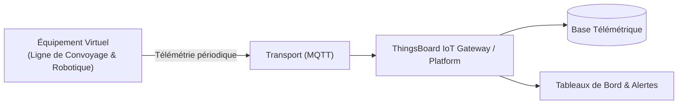

# Cas d'Usage Métier : Ligne de Convoyage & Robotique

> **Secteur d'Activité** : Industrie & Automatismes  
> **Identifiant du Modèle** : `ind_conveyor`  
> **Protocole Recommandé** : `MQTT` | **Plateforme Cible** : ThingsBoard, Multi-Plateformes  
> **Icône Applicative** : `git-branch`

---

## 1. Contexte & Enjeux Métier

Ligne d'assemblage automatisée ou centre logistique colis. Suivi des cadences de production, disponibilité opérationnelle et calcul du Taux de Rendement Synthétique (TRS / OEE).

### Objectifs Opérationnels :
- Acquisition en temps réel des grandeurs physiques critiques sans latence.
- Surveillance continue et détection précoce des dérives ou pannes potentielles.
- Optimisation des consommations d'énergie et réduction des coûts d'exploitation et de maintenance.
- Traçabilité réglementaire et conformité aux standards de sécurité industrielle.

---

## 2. Architecture & Topologie de Communication

L'équipement virtuel `ind_conveyor` s'interface directement avec ThingsBoard ou un broker intermédiaire selon les modalités suivantes :



- **Transport standard** : `MQTT`
- **Topic MQTT / Endpoint HTTP / CoAP** :
  - **MQTT** : `v1/devices/me/telemetry` (télémétrie) et `v1/devices/me/attributes` (attributs)
  - **HTTP** : `POST /api/v1/{token}/telemetry`
  - **CoAP** : `coap://thingsboard:5683/api/v1/{token}/telemetry`

---

## 3. Dictionnaire Détaillé des Variables

| Clé (ID) | Grandeur Lisible | Type | Format | Unité | Période | Générateur / Plage | Rôle Métier & Description |
|---|---|---|---|---|---|---|---|
| `cadence_pieces` | **Cadence Instantanée** | `telemetry` | `integer` | `pièces/min` | 2.0s | Triangle [30, 85] pcs/min | Nombre de pièces usinées ou transférées par minute |
| `vitesse_bande` | **Vitesse Tapis Roulant** | `telemetry` | `float` | `m/s` | 2.0s | Sinusoïde [0.4, 1.2] m/s | Vitesse linéaire asservie par variateur de fréquence |
| `taux_rendement_trs` | **Taux Rendement Synthétique (TRS)** | `telemetry` | `float` | `%` | 10.0s | Gaussienne [78, 95] % | Indicateur d'efficacité globale OEE |

---

## 4. Schémas des Payloads JSON (ThingsBoard)

### 4.1 Télémétrie Périodique
```json
{
  "cadence_pieces": 42,
  "vitesse_bande": 24.5,
  "taux_rendement_trs": 24.5
}
```

### 4.2 Attributs d'État Partagés & Client
```json
{}
```

---

## 5. Scénarios d'Anomalies & Maintenance Prédictive

Le moteur du simulateur permet d'injecter des défaillances en direct (*Chaos Testing*) pour éprouver les règles d'alertes du serveur :

- **Pic ponctuel anormal (*Spike*)** : Simule un à-coup de pression, un choc mécanique ou une surtension transitoire.
- **Dérive continue (*Drift*)** : Simule l'encrassement progressif, le manque de lubrification ou une fuite d'étanchéité graduelle.
- **Gel de valeur (*Freeze*)** : Simule un blocage mécanique de capteur ou un convertisseur bloqué.
- **Silence radio (*Timeout*)** : Simule une perte d'alimentation du module ou une rupture de liaison télécoms.

> [!WARNING]
> **Cas de défaillance type** :  
> Bourrage tapis détecté (chute cadence à zéro), glissement de courroie avec échauffement moteur.

---

## 6. Recommandations de Visualisation & Tableaux de Bord

Pour restituer la valeur métier de cet équipement sur ThingsBoard, les widgets suivants sont conseillés :

- Jauge de cadence vs Objectif
- Widget TRS / OEE avec répartition des pertes
- Historique de production journalier
