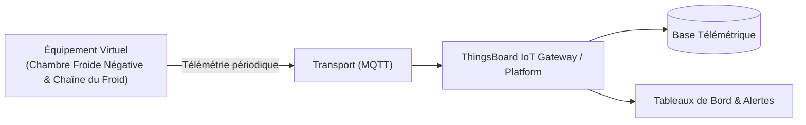

# Cas d'Usage Métier : Chambre Froide Négative & Chaîne du Froid

> **Secteur d'Activité** : Industrie & Automatismes  
> **Identifiant du Modèle** : `ind_cold_room`  
> **Protocole Recommandé** : `MQTT` | **Plateforme Cible** : ThingsBoard, Multi-Plateformes  
> **Icône Applicative** : `snowflake`

---

## 1. Contexte & Enjeux Métier

Stockage agroalimentaire grand froid (-20°C) soumis aux réglementations strictes d'hygiène et de traçabilité HACCP. Détection immédiate des ouvertures prolongées de porte et surveillance des cycles de dégivrage.

### Objectifs Opérationnels :
- Acquisition en temps réel des grandeurs physiques critiques sans latence.
- Surveillance continue et détection précoce des dérives ou pannes potentielles.
- Optimisation des consommations d'énergie et réduction des coûts d'exploitation et de maintenance.
- Traçabilité réglementaire et conformité aux standards de sécurité industrielle.

---

## 2. Architecture & Topologie de Communication

L'équipement virtuel `ind_cold_room` s'interface directement avec ThingsBoard ou un broker intermédiaire selon les modalités suivantes :



- **Transport standard** : `MQTT`
- **Topic MQTT / Endpoint HTTP / CoAP** :
  - **MQTT** : `v1/devices/me/telemetry` (télémétrie) et `v1/devices/me/attributes` (attributs)
  - **HTTP** : `POST /api/v1/{token}/telemetry`
  - **CoAP** : `coap://thingsboard:5683/api/v1/{token}/telemetry`

---

## 3. Dictionnaire Détaillé des Variables

| Clé (ID) | Grandeur Lisible | Type | Format | Unité | Période | Générateur / Plage | Rôle Métier & Description |
|---|---|---|---|---|---|---|---|
| `temp_chambre_froide` | **Température Ambiante Négative** | `telemetry` | `float` | `°C` | 5.0s | Sinusoïde [-22.0, -18.0] °C | Température d'ambiance surveillée pour HACCP |
| `temp_evaporateur` | **Température Évaporateur** | `telemetry` | `float` | `°C` | 5.0s | Sinusoïde [-28.0, -23.0] °C | Température au plus près de la détente frigorifique |
| `puissance_groupe_kw` | **Puissance Groupe Frigorifique** | `telemetry` | `float` | `kW` | 3.0s | Triangle [3.5, 12.0] kW | Consommation du compresseur à piston/vis |
| `porte_ouverte` | **Alerte Porte Ouverte** | `attribute` | `boolean` | `-` | 30.0s | Constante (False) | Statut contacteur magnétique de porte |
| `statut_degivrage` | **Cycle Dégivrage Actif** | `attribute` | `boolean` | `-` | 60.0s | Constante (False) | Inversion de cycle ou résistances électriques de dégivrage |

---

## 4. Schémas des Payloads JSON (ThingsBoard)

### 4.1 Télémétrie Périodique
```json
{
  "temp_chambre_froide": 24.5,
  "temp_evaporateur": 24.5,
  "puissance_groupe_kw": 24.5
}
```

### 4.2 Attributs d'État Partagés & Client
```json
{
  "porte_ouverte": false,
  "statut_degivrage": false
}
```

---

## 5. Scénarios d'Anomalies & Maintenance Prédictive

Le moteur du simulateur permet d'injecter des défaillances en direct (*Chaos Testing*) pour éprouver les règles d'alertes du serveur :

- **Pic ponctuel anormal (*Spike*)** : Simule un à-coup de pression, un choc mécanique ou une surtension transitoire.
- **Dérive continue (*Drift*)** : Simule l'encrassement progressif, le manque de lubrification ou une fuite d'étanchéité graduelle.
- **Gel de valeur (*Freeze*)** : Simule un blocage mécanique de capteur ou un convertisseur bloqué.
- **Silence radio (*Timeout*)** : Simule une perte d'alimentation du module ou une rupture de liaison télécoms.

> [!WARNING]
> **Cas de défaillance type** :  
> Porte maintenue ouverte provoquant une dérive thermique > -15°C, givrage excessif de la batterie de l'évaporateur.

---

## 6. Recommandations de Visualisation & Tableaux de Bord

Pour restituer la valeur métier de cet équipement sur ThingsBoard, les widgets suivants sont conseillés :

- Thermomètre digital grand froid avec zone rouge > -18°C
- Journal d'alertes HACCP horodaté
- Timeline des ouvertures de porte
