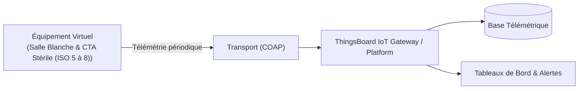

# Cas d'Usage Métier : Salle Blanche & CTA Stérile (ISO 5 à 8)

> **Secteur d'Activité** : Industrie & Automatismes  
> **Identifiant du Modèle** : `ind_cleanroom_cta`  
> **Protocole Recommandé** : `COAP` | **Plateforme Cible** : ThingsBoard, Multi-Plateformes  
> **Icône Applicative** : `shield-alert`

---

## 1. Contexte & Enjeux Métier

Environnements à contamination contrôlée (laboratoires pharmaceutiques P3/P4, salles d'opérations, photolithographie). Garantie de confinement par cascade de pression et filtration HEPA.

### Objectifs Opérationnels :
- Acquisition en temps réel des grandeurs physiques critiques sans latence.
- Surveillance continue et détection précoce des dérives ou pannes potentielles.
- Optimisation des consommations d'énergie et réduction des coûts d'exploitation et de maintenance.
- Traçabilité réglementaire et conformité aux standards de sécurité industrielle.

---

## 2. Architecture & Topologie de Communication

L'équipement virtuel `ind_cleanroom_cta` s'interface directement avec ThingsBoard ou un broker intermédiaire selon les modalités suivantes :



- **Transport standard** : `COAP`
- **Topic MQTT / Endpoint HTTP / CoAP** :
  - **MQTT** : `v1/devices/me/telemetry` (télémétrie) et `v1/devices/me/attributes` (attributs)
  - **HTTP** : `POST /api/v1/{token}/telemetry`
  - **CoAP** : `coap://thingsboard:5683/api/v1/{token}/telemetry`

---

## 3. Dictionnaire Détaillé des Variables

| Clé (ID) | Grandeur Lisible | Type | Format | Unité | Période | Générateur / Plage | Rôle Métier & Description |
|---|---|---|---|---|---|---|---|
| `surpression_salle_pa` | **Cascade Surpression Salle** | `telemetry` | `float` | `Pa` | 2.0s | Gaussienne [22.0, 35.0] Pa | Différentiel de pression entre sas et zone stérile |
| `renouvellement_air_volh` | **Taux de Renouvellement** | `telemetry` | `float` | `vol/h` | 5.0s | Sinusoïde [18.0, 24.0] vol/h | Débit horaire ramené au volume net de la salle |
| `comptage_particules_05` | **Particules ≥ 0.5 µm** | `telemetry` | `integer` | `part/m³` | 5.0s | Marche aléatoire [150, 850] | Compteur laser optique de particules en suspension |
| `humidite_absolue_gkg` | **Humidité Absolue Précision** | `telemetry` | `float` | `g/kg` | 5.0s | Sinusoïde [6.2, 8.5] g/kg | Évite les décharges électrostatiques sur wafers |
| `alarme_depressurisation` | **Alerte Rupture Surpression** | `attribute` | `boolean` | `-` | 30.0s | Constante (False) | Alarme sonore/visuelle enclenchée si P < 15 Pa |

---

## 4. Schémas des Payloads JSON (ThingsBoard)

### 4.1 Télémétrie Périodique
```json
{
  "surpression_salle_pa": 24.5,
  "renouvellement_air_volh": 24.5,
  "comptage_particules_05": 42,
  "humidite_absolue_gkg": 24.5
}
```

### 4.2 Attributs d'État Partagés, Client & RPC ThingsBoard

#### Topic d'Attributs Partagés (`v1/devices/me/attributes`)
Le simulateur publie et synchronise ses attributs d'état opérationnels :
```json
{
  "alarme_depressurisation": true
}
```

#### Pilotage par RPC Bidirectionnel (`v1/devices/me/rpc/request/{id}`)
L'opérateur peut envoyer une consigne ou basculer un état depuis un widget de tableau de bord ThingsBoard 4.3 :
```json
// Requête descendante ThingsBoard -> Simulateur
{
  "method": "set_alarme_depressurisation",
  "params": true
}

// Réponse immédiate Simulateur -> ThingsBoard (sur v1/devices/me/rpc/response/{id})
{
  "status": "SUCCESS",
  "value": true
}
```

---

## 5. Scénarios d'Anomalies & Maintenance Prédictive

Le moteur du simulateur permet d'injecter des défaillances en direct (*Chaos Testing*) pour éprouver les règles d'alertes du serveur :

- **Pic ponctuel anormal (*Spike*)** : Simule un à-coup de pression, un choc mécanique ou une surtension transitoire.
- **Dérive continue (*Drift*)** : Simule l'encrassement progressif, le manque de lubrification ou une fuite d'étanchéité graduelle.
- **Gel de valeur (*Freeze*)** : Simule un blocage mécanique de capteur ou un convertisseur bloqué.
- **Silence radio (*Timeout*)** : Simule une perte d'alimentation du module ou une rupture de liaison télécoms.

> [!WARNING]
> **Cas de défaillance type** :  
> Rupture de surpression (inversion de flux d'air contaminé), percement d'un filtre terminal avec pic particulaire.

---

## 6. Pilotage Interactif & Tableaux de Bord ThingsBoard 4.3

Le tableau de bord officiel préconfiguré [`dashboards/thingsboard/01_industrie/ind_cleanroom_cta.json`](file:///home/pierre/Projets/iot-data-simulator/dashboards/thingsboard/01_industrie/ind_cleanroom_cta.json) intègre l'ensemble des composants nécessaires à l'exploitation temps réel sous ThingsBoard 4.3 :

- **Synoptique SCADA Vectoriel P&ID (Widget HTML Card)** : Schéma de principe industriel vectoriel SVG haute résolution, adapté aux écrans de contrôle (fond clair pro WCAG AA, animations CSS de flux/rotations). Les pastilles de télémétries dynamiques sont liées par clé technique exacte (`clean_key` comme `dataKey.label`) garantissant une résolution instantanée des variables `${cle:decimales}` sous ThingsBoard 4.3.
- **Commandes & Pilotage Interactif Bidirectionnel** :
  - **Interrupteur Circulaire (*Round Switch*) - Alerte Rupture Surpression** : Commutateur interactif (`system.control_widgets.round_switch`) lié à l'attribut partagé `alarme_depressurisation` (`SHARED_SCOPE`). Permet à l'opérateur de basculer la commande (ON/OFF) depuis ThingsBoard. Le simulateur intercepte la requête RPC (`set_alarme_depressurisation` ou `setValue`), applique immédiatement la consigne avec forçage manuel (`manual_override = True`), acquitte la requête sur `v1/devices/me/rpc/response/{id}` et confirme le nouvel état d'attribut sur `v1/devices/me/attributes`.
- **Jauges Analogiques (JustGage Widgets)** : Restitution visuelle instantanée des grandeurs critiques (Cascade Surpression Salle (Pa), Taux de Renouvellement (vol/h), Particules ≥ 0.5 µm (part/m³)) avec paliers de couleur normés (vert = nominal, ambre = vigilance, rouge = seuil critique).
- **Courbes d'Historique Télémétrique & Table d'Attributs** : Graphique temporel multi-courbes synchronisé (fenêtre glissante de 24h) et vue tabulaire des attributs client/partagés.
