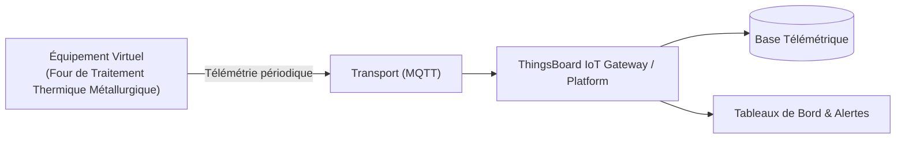

# Cas d'Usage Métier : Four de Traitement Thermique Métallurgique

> **Secteur d'Activité** : Industrie & Automatismes  
> **Identifiant du Modèle** : `ind_thermal_furnace`  
> **Protocole Recommandé** : `MQTT` | **Plateforme Cible** : ThingsBoard, Multi-Plateformes  
> **Icône Applicative** : `thermometer-sun`

---

## 1. Contexte & Enjeux Métier

Fours continus ou sous vide pour recuit, cémentation et stabilisation métallurgique. Suivi strict des rampes de température et de la répartition homogène dans les zones de chauffe.

### Objectifs Opérationnels :
- Acquisition en temps réel des grandeurs physiques critiques sans latence.
- Surveillance continue et détection précoce des dérives ou pannes potentielles.
- Optimisation des consommations d'énergie et réduction des coûts d'exploitation et de maintenance.
- Traçabilité réglementaire et conformité aux standards de sécurité industrielle.

---

## 2. Architecture & Topologie de Communication

L'équipement virtuel `ind_thermal_furnace` s'interface directement avec ThingsBoard ou un broker intermédiaire selon les modalités suivantes :



- **Transport standard** : `MQTT`
- **Topic MQTT / Endpoint HTTP / CoAP** :
  - **MQTT** : `v1/devices/me/telemetry` (télémétrie) et `v1/devices/me/attributes` (attributs)
  - **HTTP** : `POST /api/v1/{token}/telemetry`
  - **CoAP** : `coap://thingsboard:5683/api/v1/{token}/telemetry`

---

## 3. Dictionnaire Détaillé des Variables

| Clé (ID) | Grandeur Lisible | Type | Format | Unité | Période | Générateur / Plage | Rôle Métier & Description |
|---|---|---|---|---|---|---|---|
| `temp_zone_1` | **Température Zone 1 (Préchauffe)** | `telemetry` | `float` | `°C` | 3.0s | Sinusoïde [780, 850] °C | Zone amont de montée en température |
| `temp_zone_2` | **Température Zone 2 (Maintien)** | `telemetry` | `float` | `°C` | 3.0s | Sinusoïde [820, 890] °C | Zone centrale isotherme régulée |
| `temp_zone_3` | **Température Zone 3 (Homogénéisation)** | `telemetry` | `float` | `°C` | 3.0s | Sinusoïde [850, 920] °C | Palier final avant trempe |
| `debit_gaz_combustible` | **Débit Gaz Combustible** | `telemetry` | `float` | `Nm³/h` | 4.0s | Triangle [25, 75] Nm³/h | Alimentation de la rampe de brûleurs modulants |
| `puissance_bruleurs_pct` | **Modulation Puissance Brûleurs** | `telemetry` | `float` | `%` | 3.0s | Sinusoïde [40, 95] % | Signal de commande PID de la régulation |

---

## 4. Schémas des Payloads JSON (ThingsBoard)

### 4.1 Télémétrie Périodique
```json
{
  "temp_zone_1": 24.5,
  "temp_zone_2": 24.5,
  "temp_zone_3": 24.5,
  "debit_gaz_combustible": 24.5,
  "puissance_bruleurs_pct": 24.5
}
```

### 4.2 Attributs d'État Partagés & Client
```json
{}
```

---

## 5. Scénarios d'Anomalies & Maintenance Prédictive

Le moteur du simulateur permet d'injecter des défaillances en direct (*Chaos Testing*) pour éprouver les règles d'alertes du serveur :

- **Pic ponctuel anormal (*Spike*)** : Simule un à-coup de pression, un choc mécanique ou une surtension transitoire.
- **Dérive continue (*Drift*)** : Simule l'encrassement progressif, le manque de lubrification ou une fuite d'étanchéité graduelle.
- **Gel de valeur (*Freeze*)** : Simule un blocage mécanique de capteur ou un convertisseur bloqué.
- **Silence radio (*Timeout*)** : Simule une perte d'alimentation du module ou une rupture de liaison télécoms.

> [!WARNING]
> **Cas de défaillance type** :  
> Dysfonctionnement d'un brûleur gaz en zone 2, thermocouple dérivant entraînant un gradient thermique destructeur de pièce.

---

## 6. Recommandations de Visualisation & Tableaux de Bord

Pour restituer la valeur métier de cet équipement sur ThingsBoard, les widgets suivants sont conseillés :

- Profil thermique multi-zones synchronisé
- Consommation gaz cumulée par lot
- Indicateur de stabilité de consigne
