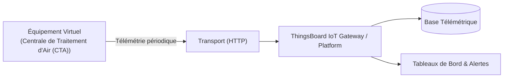

# Cas d'Usage Métier : Centrale de Traitement d'Air (CTA)

> **Secteur d'Activité** : Tertiaire & Smart Building  
> **Identifiant du Modèle** : `bldg_cta`  
> **Protocole Recommandé** : `HTTP` | **Plateforme Cible** : ThingsBoard, Multi-Plateformes  
> **Icône Applicative** : `fan`

---

## 1. Contexte & Enjeux Métier

Conditionnement climatique et renouvellement d'air neuf pour bureaux, centres commerciaux et hôpitaux. Régulation du confort thermique et surveillance de l'encrassement des filtres.

### Objectifs Opérationnels :
- Acquisition en temps réel des grandeurs physiques critiques sans latence.
- Surveillance continue et détection précoce des dérives ou pannes potentielles.
- Optimisation des consommations d'énergie et réduction des coûts d'exploitation et de maintenance.
- Traçabilité réglementaire et conformité aux standards de sécurité industrielle.

---

## 2. Architecture & Topologie de Communication

L'équipement virtuel `bldg_cta` s'interface directement avec ThingsBoard ou un broker intermédiaire selon les modalités suivantes :



- **Transport standard** : `HTTP`
- **Topic MQTT / Endpoint HTTP / CoAP** :
  - **MQTT** : `v1/devices/me/telemetry` (télémétrie) et `v1/devices/me/attributes` (attributs)
  - **HTTP** : `POST /api/v1/{token}/telemetry`
  - **CoAP** : `coap://thingsboard:5683/api/v1/{token}/telemetry`

---

## 3. Dictionnaire Détaillé des Variables

| Clé (ID) | Grandeur Lisible | Type | Format | Unité | Période | Générateur / Plage | Rôle Métier & Description |
|---|---|---|---|---|---|---|---|
| `temp_soufflage` | **Température Soufflage** | `telemetry` | `float` | `°C` | 4.0s | Sinusoïde [19.5, 22.5] °C | Air soufflé dans les gaines de distribution |
| `temp_reprise` | **Température Reprise** | `telemetry` | `float` | `°C` | 4.0s | Sinusoïde [21.0, 24.0] °C | Air extrait des bureaux réchauffé par l'occupation |
| `debit_soufflage` | **Débit d'Air Soufflé** | `telemetry` | `float` | `m³/h` | 5.0s | Marche aléatoire [1500, 4200] | Volume d'air pulsé selon le taux d'occupation |
| `pression_filtre` | **Delta Pression Filtre** | `telemetry` | `float` | `Pa` | 5.0s | Rampe [120, 280] Pa | Pression différentielle à travers les filtres F7/F9 |
| `registre_air_neuf` | **Ouverture Registre Air Neuf** | `attribute` | `integer` | `%` | 30.0s | Constante (35%) | Pourcentage de mélange air neuf / recyclé |

---

## 4. Schémas des Payloads JSON (ThingsBoard)

### 4.1 Télémétrie Périodique
```json
{
  "temp_soufflage": 24.5,
  "temp_reprise": 24.5,
  "debit_soufflage": 24.5,
  "pression_filtre": 24.5
}
```

### 4.2 Attributs d'État Partagés & Client
```json
{
  "registre_air_neuf": 10
}
```

---

## 5. Scénarios d'Anomalies & Maintenance Prédictive

Le moteur du simulateur permet d'injecter des défaillances en direct (*Chaos Testing*) pour éprouver les règles d'alertes du serveur :

- **Pic ponctuel anormal (*Spike*)** : Simule un à-coup de pression, un choc mécanique ou une surtension transitoire.
- **Dérive continue (*Drift*)** : Simule l'encrassement progressif, le manque de lubrification ou une fuite d'étanchéité graduelle.
- **Gel de valeur (*Freeze*)** : Simule un blocage mécanique de capteur ou un convertisseur bloqué.
- **Silence radio (*Timeout*)** : Simule une perte d'alimentation du module ou une rupture de liaison télécoms.

> [!WARNING]
> **Cas de défaillance type** :  
> Alerte gel batterie eau chaude par grand froid, delta P filtre anormal (filtre colmaté).

---

## 6. Recommandations de Visualisation & Tableaux de Bord

Pour restituer la valeur métier de cet équipement sur ThingsBoard, les widgets suivants sont conseillés :

- Synoptique aéraulique animé
- Jauge d'encrassement filtre avec seuil alerte > 250 Pa
- Rendement de récupération échangeur rotatif
