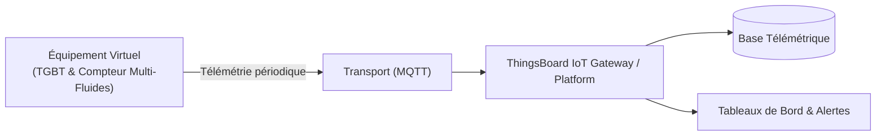

# Cas d'Usage Métier : TGBT & Compteur Multi-Fluides

> **Secteur d'Activité** : Tertiaire & Smart Building  
> **Identifiant du Modèle** : `bldg_tgbt`  
> **Protocole Recommandé** : `MQTT` | **Plateforme Cible** : ThingsBoard, Multi-Plateformes  
> **Icône Applicative** : `zap`

---

## 1. Contexte & Enjeux Métier

Supervision énergétique globale du Tableau Général Basse Tension. Analyse des puissances actives/réactives, déséquilibre de phases et suivi des consommations d'eau générale.

### Objectifs Opérationnels :
- Acquisition en temps réel des grandeurs physiques critiques sans latence.
- Surveillance continue et détection précoce des dérives ou pannes potentielles.
- Optimisation des consommations d'énergie et réduction des coûts d'exploitation et de maintenance.
- Traçabilité réglementaire et conformité aux standards de sécurité industrielle.

---

## 2. Architecture & Topologie de Communication

L'équipement virtuel `bldg_tgbt` s'interface directement avec ThingsBoard ou un broker intermédiaire selon les modalités suivantes :



- **Transport standard** : `MQTT`
- **Topic MQTT / Endpoint HTTP / CoAP** :
  - **MQTT** : `v1/devices/me/telemetry` (télémétrie) et `v1/devices/me/attributes` (attributs)
  - **HTTP** : `POST /api/v1/{token}/telemetry`
  - **CoAP** : `coap://thingsboard:5683/api/v1/{token}/telemetry`

---

## 3. Dictionnaire Détaillé des Variables

| Clé (ID) | Grandeur Lisible | Type | Format | Unité | Période | Générateur / Plage | Rôle Métier & Description |
|---|---|---|---|---|---|---|---|
| `puissance_totale_kw` | **Puissance Active Triphasée** | `telemetry` | `float` | `kW` | 2.0s | Sinusoïde [45, 180] kW | Puissance instantanée appelée par l'immeuble |
| `facteur_puissance` | **Facteur de Puissance (Cos Phi)** | `telemetry` | `float` | `-` | 3.0s | Gaussienne [0.88, 0.98] | Indice de puissance réactive inductive |
| `tension_l1_l2` | **Tension Phase-Neutre L1** | `telemetry` | `float` | `V` | 2.0s | Gaussienne [228, 234] V | Stabilité du réseau d'alimentation Enedis |
| `debit_eau_general` | **Débit Eau Générale** | `telemetry` | `float` | `m³/h` | 5.0s | Marche aléatoire [0.2, 3.8] | Comptage impulsionnel volumétrique |

---

## 4. Schémas des Payloads JSON (ThingsBoard)

### 4.1 Télémétrie Périodique
```json
{
  "puissance_totale_kw": 24.5,
  "facteur_puissance": 24.5,
  "tension_l1_l2": 24.5,
  "debit_eau_general": 24.5
}
```

### 4.2 Attributs d'État Partagés & Client
```json
{}
```

---

## 5. Scénarios d'Anomalies & Maintenance Prédictive

Le moteur du simulateur permet d'injecter des défaillances en direct (*Chaos Testing*) pour éprouver les règles d'alertes du serveur :

- **Pic ponctuel anormal (*Spike*)** : Simule un à-coup de pression, un choc mécanique ou une surtension transitoire.
- **Dérive continue (*Drift*)** : Simule l'encrassement progressif, le manque de lubrification ou une fuite d'étanchéité graduelle.
- **Gel de valeur (*Freeze*)** : Simule un blocage mécanique de capteur ou un convertisseur bloqué.
- **Silence radio (*Timeout*)** : Simule une perte d'alimentation du module ou une rupture de liaison télécoms.

> [!WARNING]
> **Cas de défaillance type** :  
> Dépassement de puissance souscrite entraînant des pénalités, dégradation du cos phi par charges non-linéaires.

---

## 6. Recommandations de Visualisation & Tableaux de Bord

Pour restituer la valeur métier de cet équipement sur ThingsBoard, les widgets suivants sont conseillés :

- Compteur de puissance active en direct
- Courbe de charge journalière / nocturne
- Détection automatique de fuite d'eau la nuit
