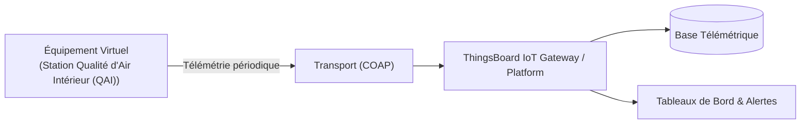

# Cas d'Usage Métier : Station Qualité d'Air Intérieur (QAI)

> **Secteur d'Activité** : Tertiaire & Smart Building  
> **Identifiant du Modèle** : `bldg_qai`  
> **Protocole Recommandé** : `COAP` | **Plateforme Cible** : ThingsBoard, Multi-Plateformes  
> **Icône Applicative** : `wind`

---

## 1. Contexte & Enjeux Métier

Conformité décret tertiaire et santé des occupants (écoles, bureaux, crèches). Mesure du confinement en CO2, des polluants chimiques COV et des particules fines.

### Objectifs Opérationnels :
- Acquisition en temps réel des grandeurs physiques critiques sans latence.
- Surveillance continue et détection précoce des dérives ou pannes potentielles.
- Optimisation des consommations d'énergie et réduction des coûts d'exploitation et de maintenance.
- Traçabilité réglementaire et conformité aux standards de sécurité industrielle.

---

## 2. Architecture & Topologie de Communication

L'équipement virtuel `bldg_qai` s'interface directement avec ThingsBoard ou un broker intermédiaire selon les modalités suivantes :



- **Transport standard** : `COAP`
- **Topic MQTT / Endpoint HTTP / CoAP** :
  - **MQTT** : `v1/devices/me/telemetry` (télémétrie) et `v1/devices/me/attributes` (attributs)
  - **HTTP** : `POST /api/v1/{token}/telemetry`
  - **CoAP** : `coap://thingsboard:5683/api/v1/{token}/telemetry`

---

## 3. Dictionnaire Détaillé des Variables

| Clé (ID) | Grandeur Lisible | Type | Format | Unité | Période | Générateur / Plage | Rôle Métier & Description |
|---|---|---|---|---|---|---|---|
| `taux_co2` | **Concentration CO₂** | `telemetry` | `integer` | `ppm` | 5.0s | Sinusoïde [450, 1350] ppm | Indicateur d'aération et de confinement |
| `particules_pm25` | **Particules Fines PM2.5** | `telemetry` | `float` | `µg/m³` | 5.0s | Gaussienne [4, 28] µg/m³ | Aérosols fins respirables |
| `cov_totaux` | **Composés Organiques Volatils (COV)** | `telemetry` | `integer` | `ppb` | 5.0s | Marche aléatoire [80, 450] | Vapeurs chimiques et solvants |
| `temp_ambiante` | **Température Ambiante** | `telemetry` | `float` | `°C` | 5.0s | Sinusoïde [20.0, 23.5] °C | Confort thermique thermique de zone |
| `humidite_ambiante` | **Humidité Relative** | `telemetry` | `float` | `%` | 5.0s | Sinusoïde [42, 62] % | Hygrométrie de zone |

---

## 4. Schémas des Payloads JSON (ThingsBoard)

### 4.1 Télémétrie Périodique
```json
{
  "taux_co2": 42,
  "particules_pm25": 24.5,
  "cov_totaux": 42,
  "temp_ambiante": 24.5,
  "humidite_ambiante": 24.5
}
```

### 4.2 Attributs d'État Partagés & Client
```json
{}
```

---

## 5. Scénarios d'Anomalies & Maintenance Prédictive

Le moteur du simulateur permet d'injecter des défaillances en direct (*Chaos Testing*) pour éprouver les règles d'alertes du serveur :

- **Pic ponctuel anormal (*Spike*)** : Simule un à-coup de pression, un choc mécanique ou une surtension transitoire.
- **Dérive continue (*Drift*)** : Simule l'encrassement progressif, le manque de lubrification ou une fuite d'étanchéité graduelle.
- **Gel de valeur (*Freeze*)** : Simule un blocage mécanique de capteur ou un convertisseur bloqué.
- **Silence radio (*Timeout*)** : Simule une perte d'alimentation du module ou une rupture de liaison télécoms.

> [!WARNING]
> **Cas de défaillance type** :  
> Pic de CO2 > 1200 ppm nécessitant le forçage de l'aération, pic de COV lié à des produits d'entretien.

---

## 6. Recommandations de Visualisation & Tableaux de Bord

Pour restituer la valeur métier de cet équipement sur ThingsBoard, les widgets suivants sont conseillés :

- Indice global de qualité d'air (Vert / Orange / Rouge)
- Badge de niveau CO2 avec alerte aération
- Graphique croisé Température / Hygrométrie (Diagramme Givoni)
