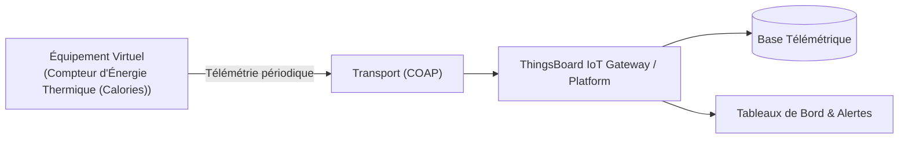

# Cas d'Usage Métier : Compteur d'Énergie Thermique (Calories)

> **Secteur d'Activité** : Tertiaire & Smart Building  
> **Identifiant du Modèle** : `bldg_thermal_meter`  
> **Protocole Recommandé** : `COAP` | **Plateforme Cible** : ThingsBoard, Multi-Plateformes  
> **Icône Applicative** : `activity`

---

## 1. Contexte & Enjeux Métier

Sous-comptage calorifique MID pour audits énergétiques (bâtiments tertiaires, cliniques, logements collectifs). Calcul en continu de la chaleur consommée à partir du débit et du différentiel de température.

### Objectifs Opérationnels :
- Acquisition en temps réel des grandeurs physiques critiques sans latence.
- Surveillance continue et détection précoce des dérives ou pannes potentielles.
- Optimisation des consommations d'énergie et réduction des coûts d'exploitation et de maintenance.
- Traçabilité réglementaire et conformité aux standards de sécurité industrielle.

---

## 2. Architecture & Topologie de Communication

L'équipement virtuel `bldg_thermal_meter` s'interface directement avec ThingsBoard ou un broker intermédiaire selon les modalités suivantes :



- **Transport standard** : `COAP`
- **Topic MQTT / Endpoint HTTP / CoAP** :
  - **MQTT** : `v1/devices/me/telemetry` (télémétrie) et `v1/devices/me/attributes` (attributs)
  - **HTTP** : `POST /api/v1/{token}/telemetry`
  - **CoAP** : `coap://thingsboard:5683/api/v1/{token}/telemetry`

---

## 3. Dictionnaire Détaillé des Variables

| Clé (ID) | Grandeur Lisible | Type | Format | Unité | Période | Générateur / Plage | Rôle Métier & Description |
|---|---|---|---|---|---|---|---|
| `debit_volumique_m3h` | **Débit Volumique Fluide** | `telemetry` | `float` | `m³/h` | 4.0s | Marche aléatoire [1.2, 8.5] | Vitesse d'écoulement de l'eau caloporteuse |
| `delta_t_deg` | **Écart Température Aller/Retour** | `telemetry` | `float` | `°C` | 4.0s | Sinusoïde [5.0, 18.0] °C | Différence thermique absorbée par les sous-stations |
| `puissance_thermique_kw` | **Puissance Thermique Instantanée** | `telemetry` | `float` | `kW` | 3.0s | Sinusoïde [25, 140] kW | Q = m * Cp * Delta T calculé en direct |
| `energie_cumulee_mwh` | **Énergie Calorifique Cumulée** | `telemetry` | `float` | `MWh` | 10.0s | Rampe [142, 155] MWh | Index compteur pour facturation et décret BACS |
| `temp_depart_eau` | **Température Départ Eau Chaude** | `telemetry` | `float` | `°C` | 4.0s | Sinusoïde [65, 78] °C | Température injectée dans le réseau primaire |

---

## 4. Schémas des Payloads JSON (ThingsBoard)

### 4.1 Télémétrie Périodique
```json
{
  "debit_volumique_m3h": 24.5,
  "delta_t_deg": 24.5,
  "puissance_thermique_kw": 24.5,
  "energie_cumulee_mwh": 24.5,
  "temp_depart_eau": 24.5
}
```

### 4.2 Attributs d'État Partagés, Client & RPC ThingsBoard

```json
{
  "modele": "Compteur d'Énergie Thermique (Calories)",
  "firmware_version": "v2.4.1",
  "statut_equipement": "OPERATIONNEL"
}
```

---

## 5. Scénarios d'Anomalies & Maintenance Prédictive

Le moteur du simulateur permet d'injecter des défaillances en direct (*Chaos Testing*) pour éprouver les règles d'alertes du serveur :

- **Pic ponctuel anormal (*Spike*)** : Simule un à-coup de pression, un choc mécanique ou une surtension transitoire.
- **Dérive continue (*Drift*)** : Simule l'encrassement progressif, le manque de lubrification ou une fuite d'étanchéité graduelle.
- **Gel de valeur (*Freeze*)** : Simule un blocage mécanique de capteur ou un convertisseur bloqué.
- **Silence radio (*Timeout*)** : Simule une perte d'alimentation du module ou une rupture de liaison télécoms.

> [!WARNING]
> **Cas de défaillance type** :  
> Inversion de sondes aller/retour (Delta T négatif), blocage mécanique de la turbine de mesure de débit.

---

## 6. Pilotage Interactif & Tableaux de Bord ThingsBoard 4.3

Le tableau de bord officiel préconfiguré [`dashboards/thingsboard/02_tertiaire/bldg_thermal_meter.json`](file:///home/pierre/Projets/iot-data-simulator/dashboards/thingsboard/02_tertiaire/bldg_thermal_meter.json) intègre l'ensemble des composants nécessaires à l'exploitation temps réel sous ThingsBoard 4.3 :

- **Synoptique SCADA Vectoriel P&ID (Widget HTML Card)** : Schéma de principe industriel vectoriel SVG haute résolution, adapté aux écrans de contrôle (fond clair pro WCAG AA, animations CSS de flux/rotations). Les pastilles de télémétries dynamiques sont liées par clé technique exacte (`clean_key` comme `dataKey.label`) garantissant une résolution instantanée des variables `${cle:decimales}` sous ThingsBoard 4.3.
- **Mode Opérationnel Autonome & Télémétrie Pure** : Cet équipement fonctionne en régulation automatique continue. Les attributs affichés dans la table récapitulative fournissent les métadonnées d'inventaire technique (modèle constructeur, révision logicielle, protocole de liaison).
- **Jauges Analogiques (JustGage Widgets)** : Restitution visuelle instantanée des grandeurs critiques (Débit Volumique Fluide (m³/h), Écart Température Aller/Retour (°C), Puissance Thermique Instantanée (kW)) avec paliers de couleur normés (vert = nominal, ambre = vigilance, rouge = seuil critique).
- **Courbes d'Historique Télémétrique & Table d'Attributs** : Graphique temporel multi-courbes synchronisé (fenêtre glissante de 24h) et vue tabulaire des attributs client/partagés.
