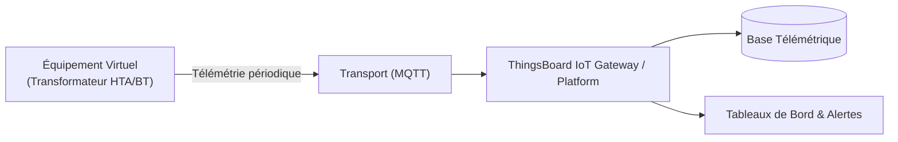

# Cas d'Usage Métier : Transformateur HTA/BT

> **Secteur d'Activité** : Infrastructures & Énergie  
> **Identifiant du Modèle** : `infra_transfo_hta`  
> **Protocole Recommandé** : `MQTT` | **Plateforme Cible** : ThingsBoard, Multi-Plateformes  
> **Icône Applicative** : `radio`

---

## 1. Contexte & Enjeux Métier

Poste de transformation moyenne tension vers basse tension (20 kV / 400 V). Surveillance thermique du diélectrique, du taux de charge et relais de protection intégrée DGPT2.

### Objectifs Opérationnels :
- Acquisition en temps réel des grandeurs physiques critiques sans latence.
- Surveillance continue et détection précoce des dérives ou pannes potentielles.
- Optimisation des consommations d'énergie et réduction des coûts d'exploitation et de maintenance.
- Traçabilité réglementaire et conformité aux standards de sécurité industrielle.

---

## 2. Architecture & Topologie de Communication

L'équipement virtuel `infra_transfo_hta` s'interface directement avec ThingsBoard ou un broker intermédiaire selon les modalités suivantes :



- **Transport standard** : `MQTT`
- **Topic MQTT / Endpoint HTTP / CoAP** :
  - **MQTT** : `v1/devices/me/telemetry` (télémétrie) et `v1/devices/me/attributes` (attributs)
  - **HTTP** : `POST /api/v1/{token}/telemetry`
  - **CoAP** : `coap://thingsboard:5683/api/v1/{token}/telemetry`

---

## 3. Dictionnaire Détaillé des Variables

| Clé (ID) | Grandeur Lisible | Type | Format | Unité | Période | Générateur / Plage | Rôle Métier & Description |
|---|---|---|---|---|---|---|---|
| `temp_huile_transfo` | **Température Huile Diélectrique** | `telemetry` | `float` | `°C` | 5.0s | Sinusoïde [52, 74] °C | Échauffement interne de l'huile minérale |
| `charge_transfo_pct` | **Taux de Charge Transformateur** | `telemetry` | `float` | `%` | 3.0s | Triangle [35, 88] % | Rapport puissance appelée / puissance nominale kVA |
| `pression_cuve` | **Pression Interne Cuve** | `telemetry` | `float` | `mbar` | 5.0s | Gaussienne [140, 220] mbar | Pression d'huile scellée |
| `taux_thd` | **Taux Harmonique THD-I** | `telemetry` | `float` | `%` | 3.0s | Gaussienne [2.1, 6.4] % | Pollution harmonique réinjectée |
| `alarme_dgpt2` | **Alerte Sécurité DGPT2** | `attribute` | `boolean` | `-` | 60.0s | Constante (False) | Relais Décharge Gaz Pression Température |

---

## 4. Schémas des Payloads JSON (ThingsBoard)

### 4.1 Télémétrie Périodique
```json
{
  "temp_huile_transfo": 24.5,
  "charge_transfo_pct": 24.5,
  "pression_cuve": 24.5,
  "taux_thd": 24.5
}
```

### 4.2 Attributs d'État Partagés & Client
```json
{
  "alarme_dgpt2": false
}
```

---

## 5. Scénarios d'Anomalies & Maintenance Prédictive

Le moteur du simulateur permet d'injecter des défaillances en direct (*Chaos Testing*) pour éprouver les règles d'alertes du serveur :

- **Pic ponctuel anormal (*Spike*)** : Simule un à-coup de pression, un choc mécanique ou une surtension transitoire.
- **Dérive continue (*Drift*)** : Simule l'encrassement progressif, le manque de lubrification ou une fuite d'étanchéité graduelle.
- **Gel de valeur (*Freeze*)** : Simule un blocage mécanique de capteur ou un convertisseur bloqué.
- **Silence radio (*Timeout*)** : Simule une perte d'alimentation du module ou une rupture de liaison télécoms.

> [!WARNING]
> **Cas de défaillance type** :  
> Alerte seuil température huile > 85°C, déclenchement relais DGPT2 pour surpression ou dégagement gazeux.

---

## 6. Recommandations de Visualisation & Tableaux de Bord

Pour restituer la valeur métier de cet équipement sur ThingsBoard, les widgets suivants sont conseillés :

- Jauge thermique avec zone critique > 80°C
- Courbe de taux de charge en kVA
- Voyants de sécurité DGPT2
