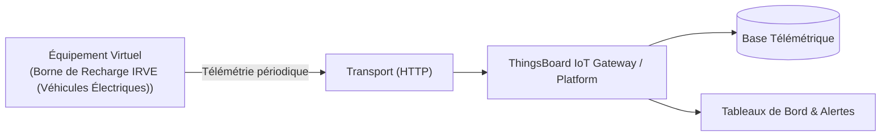

# Cas d'Usage Métier : Borne de Recharge IRVE (Véhicules Électriques)

> **Secteur d'Activité** : Infrastructures & Énergie  
> **Identifiant du Modèle** : `infra_irve_charger`  
> **Protocole Recommandé** : `HTTP` | **Plateforme Cible** : ThingsBoard, Multi-Plateformes  
> **Icône Applicative** : `battery-charging`

---

## 1. Contexte & Enjeux Métier

Borne de recharge publique ou d'entreprise (22 kW AC à 150 kW DC). Pilotage dynamique de la charge, comptage des sessions de recharge et supervision de la connectivité OCPP.

### Objectifs Opérationnels :
- Acquisition en temps réel des grandeurs physiques critiques sans latence.
- Surveillance continue et détection précoce des dérives ou pannes potentielles.
- Optimisation des consommations d'énergie et réduction des coûts d'exploitation et de maintenance.
- Traçabilité réglementaire et conformité aux standards de sécurité industrielle.

---

## 2. Architecture & Topologie de Communication

L'équipement virtuel `infra_irve_charger` s'interface directement avec ThingsBoard ou un broker intermédiaire selon les modalités suivantes :



- **Transport standard** : `HTTP`
- **Topic MQTT / Endpoint HTTP / CoAP** :
  - **MQTT** : `v1/devices/me/telemetry` (télémétrie) et `v1/devices/me/attributes` (attributs)
  - **HTTP** : `POST /api/v1/{token}/telemetry`
  - **CoAP** : `coap://thingsboard:5683/api/v1/{token}/telemetry`

---

## 3. Dictionnaire Détaillé des Variables

| Clé (ID) | Grandeur Lisible | Type | Format | Unité | Période | Générateur / Plage | Rôle Métier & Description |
|---|---|---|---|---|---|---|---|
| `puissance_charge_kw` | **Puissance de Charge Délivrée** | `telemetry` | `float` | `kW` | 2.0s | Table de points [0, 22] kW | Profil de charge CC/CV selon la courbe de batterie |
| `energie_session_kwh` | **Énergie Consommée Session** | `telemetry` | `float` | `kWh` | 4.0s | Rampe [0, 42] kWh | Énergie cumulée facturée pour la session |
| `courant_charge_a` | **Courant Délivré Prise** | `telemetry` | `float` | `A` | 2.0s | Sinusoïde [0, 32] A | Intensité régulée par le contrôleur de charge |
| `statut_connecteur` | **Statut Prise Type 2** | `attribute` | `string` | `-` | 30.0s | Constante ('CHARGING') | Occupé, Disponible, En attente, En défaut |

---

## 4. Schémas des Payloads JSON (ThingsBoard)

### 4.1 Télémétrie Périodique
```json
{
  "puissance_charge_kw": 24.5,
  "energie_session_kwh": 24.5,
  "courant_charge_a": 24.5
}
```

### 4.2 Attributs d'État Partagés & Client
```json
{
  "statut_connecteur": "NORMAL"
}
```

---

## 5. Scénarios d'Anomalies & Maintenance Prédictive

Le moteur du simulateur permet d'injecter des défaillances en direct (*Chaos Testing*) pour éprouver les règles d'alertes du serveur :

- **Pic ponctuel anormal (*Spike*)** : Simule un à-coup de pression, un choc mécanique ou une surtension transitoire.
- **Dérive continue (*Drift*)** : Simule l'encrassement progressif, le manque de lubrification ou une fuite d'étanchéité graduelle.
- **Gel de valeur (*Freeze*)** : Simule un blocage mécanique de capteur ou un convertisseur bloqué.
- **Silence radio (*Timeout*)** : Simule une perte d'alimentation du module ou une rupture de liaison télécoms.

> [!WARNING]
> **Cas de défaillance type** :  
> Coupure inopinée de session par défaut d'isolement véhicule, surchauffe du câble de charge.

---

## 6. Recommandations de Visualisation & Tableaux de Bord

Pour restituer la valeur métier de cet équipement sur ThingsBoard, les widgets suivants sont conseillés :

- Jauge de puissance de charge en temps réel
- Compteur de session kWh et tarif calculé
- Statut du connecteur (Occupé/Libre)
