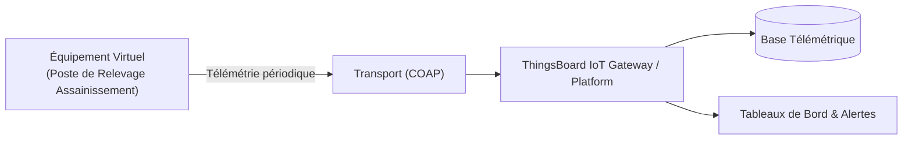

# Cas d'Usage Métier : Poste de Relevage Assainissement

> **Secteur d'Activité** : Infrastructures & Énergie  
> **Identifiant du Modèle** : `infra_water_pump`  
> **Protocole Recommandé** : `COAP` | **Plateforme Cible** : ThingsBoard, Multi-Plateformes  
> **Icône Applicative** : `droplets`

---

## 1. Contexte & Enjeux Métier

Évacuation des eaux usées et pluviales dans les réseaux d'assainissement collectifs. Gestion de l'alternance de pompes immergées et prévention des débordements en cas d'orage.

### Objectifs Opérationnels :
- Acquisition en temps réel des grandeurs physiques critiques sans latence.
- Surveillance continue et détection précoce des dérives ou pannes potentielles.
- Optimisation des consommations d'énergie et réduction des coûts d'exploitation et de maintenance.
- Traçabilité réglementaire et conformité aux standards de sécurité industrielle.

---

## 2. Architecture & Topologie de Communication

L'équipement virtuel `infra_water_pump` s'interface directement avec ThingsBoard ou un broker intermédiaire selon les modalités suivantes :



- **Transport standard** : `COAP`
- **Topic MQTT / Endpoint HTTP / CoAP** :
  - **MQTT** : `v1/devices/me/telemetry` (télémétrie) et `v1/devices/me/attributes` (attributs)
  - **HTTP** : `POST /api/v1/{token}/telemetry`
  - **CoAP** : `coap://thingsboard:5683/api/v1/{token}/telemetry`

---

## 3. Dictionnaire Détaillé des Variables

| Clé (ID) | Grandeur Lisible | Type | Format | Unité | Période | Générateur / Plage | Rôle Métier & Description |
|---|---|---|---|---|---|---|---|
| `niveau_bache_m` | **Niveau d'Eau en Bâche** | `telemetry` | `float` | `m` | 3.0s | Dent de scie [0.6, 3.4] m | Hauteur d'eau mesurée en cuve de relevage |
| `debit_refoulement` | **Débit Pompe de Refoulement** | `telemetry` | `float` | `m³/h` | 3.0s | Carré [0, 85] m³/h | Débit volumique d'eau propulsée vers le collecteur |
| `conso_pompe_kw` | **Puissance Électrique Pompe** | `telemetry` | `float` | `kW` | 3.0s | Carré [0, 18.5] kW | Consommation du moteur submersible |
| `alarme_debordement` | **Alerte Trop-Plein / Débordement** | `attribute` | `boolean` | `-` | 60.0s | Constante (False) | Flotteur de sécurité niveau très haut |

---

## 4. Schémas des Payloads JSON (ThingsBoard)

### 4.1 Télémétrie Périodique
```json
{
  "niveau_bache_m": 24.5,
  "debit_refoulement": 24.5,
  "conso_pompe_kw": 24.5
}
```

### 4.2 Attributs d'État Partagés & Client
```json
{
  "alarme_debordement": false
}
```

---

## 5. Scénarios d'Anomalies & Maintenance Prédictive

Le moteur du simulateur permet d'injecter des défaillances en direct (*Chaos Testing*) pour éprouver les règles d'alertes du serveur :

- **Pic ponctuel anormal (*Spike*)** : Simule un à-coup de pression, un choc mécanique ou une surtension transitoire.
- **Dérive continue (*Drift*)** : Simule l'encrassement progressif, le manque de lubrification ou une fuite d'étanchéité graduelle.
- **Gel de valeur (*Freeze*)** : Simule un blocage mécanique de capteur ou un convertisseur bloqué.
- **Silence radio (*Timeout*)** : Simule une perte d'alimentation du module ou une rupture de liaison télécoms.

> [!WARNING]
> **Cas de défaillance type** :  
> Blocage mécanique de la pompe par corps solide (surintensité), sonde de niveau ultrason en défaut.

---

## 6. Recommandations de Visualisation & Tableaux de Bord

Pour restituer la valeur métier de cet équipement sur ThingsBoard, les widgets suivants sont conseillés :

- Niveau de cuve animé avec seuils démarrage/arrêt
- Graphique des temps de fonctionnement pompes 1 & 2
- Alerte sms/mail de débordement
