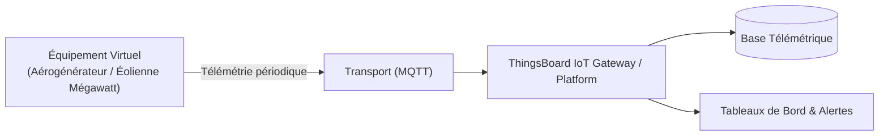

# Cas d'Usage Métier : Aérogénérateur / Éolienne Mégawatt

> **Secteur d'Activité** : Infrastructures & Énergie  
> **Identifiant du Modèle** : `infra_wind_turbine`  
> **Protocole Recommandé** : `MQTT` | **Plateforme Cible** : ThingsBoard, Multi-Plateformes  
> **Icône Applicative** : `wind`

---

## 1. Contexte & Enjeux Métier

Parc éolien terrestre ou offshore (turbines 2 à 5 MW). Contrôle d'orientation nacelle (Yaw), calage de pales (Pitch), et surveillance de la ligne d'arbre et de la génératrice.

### Objectifs Opérationnels :
- Acquisition en temps réel des grandeurs physiques critiques sans latence.
- Surveillance continue et détection précoce des dérives ou pannes potentielles.
- Optimisation des consommations d'énergie et réduction des coûts d'exploitation et de maintenance.
- Traçabilité réglementaire et conformité aux standards de sécurité industrielle.

---

## 2. Architecture & Topologie de Communication

L'équipement virtuel `infra_wind_turbine` s'interface directement avec ThingsBoard ou un broker intermédiaire selon les modalités suivantes :



- **Transport standard** : `MQTT`
- **Topic MQTT / Endpoint HTTP / CoAP** :
  - **MQTT** : `v1/devices/me/telemetry` (télémétrie) et `v1/devices/me/attributes` (attributs)
  - **HTTP** : `POST /api/v1/{token}/telemetry`
  - **CoAP** : `coap://thingsboard:5683/api/v1/{token}/telemetry`

---

## 3. Dictionnaire Détaillé des Variables

| Clé (ID) | Grandeur Lisible | Type | Format | Unité | Période | Générateur / Plage | Rôle Métier & Description |
|---|---|---|---|---|---|---|---|
| `vitesse_vent_ms` | **Vitesse Vent Anémomètre** | `telemetry` | `float` | `m/s` | 2.0s | Gaussienne [4.5, 18.5] m/s | Vitesse du vent mesurée au mât météorologique |
| `vitesse_rotor_rpm` | **Vitesse de Rotation Rotor** | `telemetry` | `float` | `rpm` | 2.0s | Sinusoïde [8.0, 17.5] rpm | Rotation des pales sur l'arbre lent |
| `puissance_active_mw` | **Puissance Électrique Active** | `telemetry` | `float` | `MW` | 2.0s | Sinusoïde [0.4, 2.8] MW | Électricité injectée sur le poste d'évacuation HTA |
| `angle_nacelle_yaw_deg` | **Orientation Nacelle (Yaw)** | `telemetry` | `float` | `°` | 10.0s | Marche aléatoire [45, 315] ° | Positionnement face au vent par motoréducteurs |
| `temp_generatrice` | **Température Génératrice** | `telemetry` | `float` | `°C` | 5.0s | Sinusoïde [55, 82] °C | Échauffement du stator et des bobinages |

---

## 4. Schémas des Payloads JSON (ThingsBoard)

### 4.1 Télémétrie Périodique
```json
{
  "vitesse_vent_ms": 24.5,
  "vitesse_rotor_rpm": 24.5,
  "puissance_active_mw": 24.5,
  "angle_nacelle_yaw_deg": 24.5,
  "temp_generatrice": 24.5
}
```

### 4.2 Attributs d'État Partagés, Client & RPC ThingsBoard

```json
{
  "modele": "Aérogénérateur / Éolienne MW",
  "firmware_version": "v2.4.1",
  "statut_equipement": "OPERATIONNEL"
}
```

---

## 5. Scénarios d'Anomalies & Maintenance Prédictive

Le moteur du simulateur permet d'injecter des défaillances en direct (*Chaos Testing*) pour éprouver les règles d'alertes du serveur :

- **Pic ponctuel anormal (*Spike*)** : Simule un à-coup de pression, un choc mécanique ou une surtension transitoire.
- **Dérive continue (*Drift*)** : Simule l'encrassement progressif, le manque de lubrification ou une fuite d'étanchéité graduelle.
- **Gel de valeur (*Freeze*)** : Simule un blocage mécanique de capteur ou un convertisseur bloqué.
- **Silence radio (*Timeout*)** : Simule une perte d'alimentation du module ou une rupture de liaison télécoms.

> [!WARNING]
> **Cas de défaillance type** :  
> Température génératrice excessive en pleine charge, vent fort nécessitant la mise en drapeau de sécurité.

---

## 6. Pilotage Interactif & Tableaux de Bord ThingsBoard 4.3

Le tableau de bord officiel préconfiguré [`dashboards/thingsboard/03_infrastructures/infra_wind_turbine.json`](file:///home/pierre/Projets/iot-data-simulator/dashboards/thingsboard/03_infrastructures/infra_wind_turbine.json) intègre l'ensemble des composants nécessaires à l'exploitation temps réel sous ThingsBoard 4.3 :

- **Synoptique SCADA Vectoriel P&ID (Widget HTML Card)** : Schéma de principe industriel vectoriel SVG haute résolution, adapté aux écrans de contrôle (fond clair pro WCAG AA, animations CSS de flux/rotations). Les pastilles de télémétries dynamiques sont liées par clé technique exacte (`clean_key` comme `dataKey.label`) garantissant une résolution instantanée des variables `${cle:decimales}` sous ThingsBoard 4.3.
- **Mode Opérationnel Autonome & Télémétrie Pure** : Cet équipement fonctionne en régulation automatique continue. Les attributs affichés dans la table récapitulative fournissent les métadonnées d'inventaire technique (modèle constructeur, révision logicielle, protocole de liaison).
- **Jauges Analogiques (JustGage Widgets)** : Restitution visuelle instantanée des grandeurs critiques (Vitesse Vent Anémomètre (m/s), Vitesse de Rotation Rotor (rpm), Puissance Électrique Active (MW)) avec paliers de couleur normés (vert = nominal, ambre = vigilance, rouge = seuil critique).
- **Courbes d'Historique Télémétrique & Table d'Attributs** : Graphique temporel multi-courbes synchronisé (fenêtre glissante de 24h) et vue tabulaire des attributs client/partagés.
