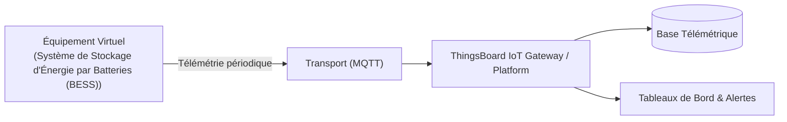

# Cas d'Usage Métier : Système de Stockage d'Énergie par Batteries (BESS)

> **Secteur d'Activité** : Infrastructures & Énergie  
> **Identifiant du Modèle** : `infra_bess_storage`  
> **Protocole Recommandé** : `MQTT` | **Plateforme Cible** : ThingsBoard, Multi-Plateformes  
> **Icône Applicative** : `battery-medium`

---

## 1. Contexte & Enjeux Métier

Conteneur de batteries lithium stationnaire (1 à 10 MWh) pour régulation de fréquence réseau, écrêtage de pointes et stockage d'énergies renouvelables.

### Objectifs Opérationnels :
- Acquisition en temps réel des grandeurs physiques critiques sans latence.
- Surveillance continue et détection précoce des dérives ou pannes potentielles.
- Optimisation des consommations d'énergie et réduction des coûts d'exploitation et de maintenance.
- Traçabilité réglementaire et conformité aux standards de sécurité industrielle.

---

## 2. Architecture & Topologie de Communication

L'équipement virtuel `infra_bess_storage` s'interface directement avec ThingsBoard ou un broker intermédiaire selon les modalités suivantes :



- **Transport standard** : `MQTT`
- **Topic MQTT / Endpoint HTTP / CoAP** :
  - **MQTT** : `v1/devices/me/telemetry` (télémétrie) et `v1/devices/me/attributes` (attributs)
  - **HTTP** : `POST /api/v1/{token}/telemetry`
  - **CoAP** : `coap://thingsboard:5683/api/v1/{token}/telemetry`

---

## 3. Dictionnaire Détaillé des Variables

| Clé (ID) | Grandeur Lisible | Type | Format | Unité | Période | Générateur / Plage | Rôle Métier & Description |
|---|---|---|---|---|---|---|---|
| `soc_pct` | **État de Charge (SoC)** | `telemetry` | `float` | `%` | 5.0s | Triangle [20, 95] % | Pourcentage d'énergie utile restante |
| `tension_pack_v` | **Tension Bus Continu DC** | `telemetry` | `float` | `V` | 2.0s | Gaussienne [720, 810] V | Tension du banc de batteries série/parallèle |
| `courant_charge_decharge_a` | **Courant Charge / Décharge** | `telemetry` | `float` | `A` | 2.0s | Sinusoïde [-120, 120] A | Positif = Décharge réseau, Négatif = Charge |
| `temp_max_cellule` | **Température Cellule Critique** | `telemetry` | `float` | `°C` | 5.0s | Sinusoïde [24, 38] °C | Point chaud mesuré par le Battery Management System (BMS) |
| `soh_pct` | **État de Santé Batterie (SoH)** | `attribute` | `float` | `%` | 60.0s | Constante (97.4%) | Capacité résiduelle par rapport au nominal d'origine |

---

## 4. Schémas des Payloads JSON (ThingsBoard)

### 4.1 Télémétrie Périodique
```json
{
  "soc_pct": 24.5,
  "tension_pack_v": 24.5,
  "courant_charge_decharge_a": 24.5,
  "temp_max_cellule": 24.5
}
```

### 4.2 Attributs d'État Partagés, Client & RPC ThingsBoard

#### Topic d'Attributs Partagés (`v1/devices/me/attributes`)
Le simulateur publie et synchronise ses attributs d'état opérationnels :
```json
{
  "soh_pct": 100
}
```

#### Pilotage par RPC Bidirectionnel (`v1/devices/me/rpc/request/{id}`)
L'opérateur peut envoyer une consigne ou basculer un état depuis un widget de tableau de bord ThingsBoard 4.3 :
```json
// Requête descendante ThingsBoard -> Simulateur
{
  "method": "set_soh_pct",
  "params": "AUTO"
}

// Réponse immédiate Simulateur -> ThingsBoard (sur v1/devices/me/rpc/response/{id})
{
  "status": "SUCCESS",
  "value": "AUTO"
}
```

---

## 5. Scénarios d'Anomalies & Maintenance Prédictive

Le moteur du simulateur permet d'injecter des défaillances en direct (*Chaos Testing*) pour éprouver les règles d'alertes du serveur :

- **Pic ponctuel anormal (*Spike*)** : Simule un à-coup de pression, un choc mécanique ou une surtension transitoire.
- **Dérive continue (*Drift*)** : Simule l'encrassement progressif, le manque de lubrification ou une fuite d'étanchéité graduelle.
- **Gel de valeur (*Freeze*)** : Simule un blocage mécanique de capteur ou un convertisseur bloqué.
- **Silence radio (*Timeout*)** : Simule une perte d'alimentation du module ou une rupture de liaison télécoms.

> [!WARNING]
> **Cas de défaillance type** :  
> Échauffement anormal d'une cellule (emballement thermique naissant), déséquilibre de tension entre racks.

---

## 6. Pilotage Interactif & Tableaux de Bord ThingsBoard 4.3

Le tableau de bord officiel préconfiguré [`dashboards/thingsboard/03_infrastructures/infra_bess_storage.json`](file:///home/pierre/Projets/iot-data-simulator/dashboards/thingsboard/03_infrastructures/infra_bess_storage.json) intègre l'ensemble des composants nécessaires à l'exploitation temps réel sous ThingsBoard 4.3 :

- **Synoptique SCADA Vectoriel P&ID (Widget HTML Card)** : Schéma de principe industriel vectoriel SVG haute résolution, adapté aux écrans de contrôle (fond clair pro WCAG AA, animations CSS de flux/rotations). Les pastilles de télémétries dynamiques sont liées par clé technique exacte (`clean_key` comme `dataKey.label`) garantissant une résolution instantanée des variables `${cle:decimales}` sous ThingsBoard 4.3.
- **Commandes & Pilotage Interactif Bidirectionnel** :
  - **Formulaire de Consigne (*Update Multiple Attributes*) - État de Santé Batterie (SoH)** : Widget de saisie interactif (`system.input_widgets.update_multiple_attributes`) permettant de renseigner la consigne `soh_pct` (float). Les modifications sont instantanément répercutées dans la simulation physique via l'abonnement aux attributs partagés.
- **Jauges Analogiques (JustGage Widgets)** : Restitution visuelle instantanée des grandeurs critiques (État de Charge (SoC) (%), Tension Bus Continu DC (V), Courant Charge / Décharge (A)) avec paliers de couleur normés (vert = nominal, ambre = vigilance, rouge = seuil critique).
- **Courbes d'Historique Télémétrique & Table d'Attributs** : Graphique temporel multi-courbes synchronisé (fenêtre glissante de 24h) et vue tabulaire des attributs client/partagés.
