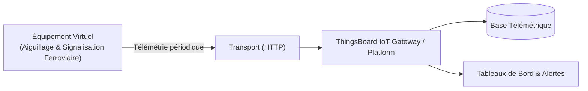

# Cas d'Usage Métier : Aiguillage & Signalisation Ferroviaire

> **Secteur d'Activité** : Infrastructures & Énergie  
> **Identifiant du Modèle** : `infra_rail_switch`  
> **Protocole Recommandé** : `HTTP` | **Plateforme Cible** : ThingsBoard, Multi-Plateformes  
> **Icône Applicative** : `train`

---

## 1. Contexte & Enjeux Métier

Appareils de voie (ADV) pour réseaux ferrés, métros et tramways. Détection prédictive de grippage mécanique, surveillance du temps de basculement et réchauffage anti-gel.

### Objectifs Opérationnels :
- Acquisition en temps réel des grandeurs physiques critiques sans latence.
- Surveillance continue et détection précoce des dérives ou pannes potentielles.
- Optimisation des consommations d'énergie et réduction des coûts d'exploitation et de maintenance.
- Traçabilité réglementaire et conformité aux standards de sécurité industrielle.

---

## 2. Architecture & Topologie de Communication

L'équipement virtuel `infra_rail_switch` s'interface directement avec ThingsBoard ou un broker intermédiaire selon les modalités suivantes :



- **Transport standard** : `HTTP`
- **Topic MQTT / Endpoint HTTP / CoAP** :
  - **MQTT** : `v1/devices/me/telemetry` (télémétrie) et `v1/devices/me/attributes` (attributs)
  - **HTTP** : `POST /api/v1/{token}/telemetry`
  - **CoAP** : `coap://thingsboard:5683/api/v1/{token}/telemetry`

---

## 3. Dictionnaire Détaillé des Variables

| Clé (ID) | Grandeur Lisible | Type | Format | Unité | Période | Générateur / Plage | Rôle Métier & Description |
|---|---|---|---|---|---|---|---|
| `courant_moteur_aiguille_a` | **Courant d'Effort Manœuvre** | `telemetry` | `float` | `A` | 2.0s | Carré [0.0, 8.2] A | Signature de courant pendant le déplacement des lames |
| `temps_manoeuvre_ms` | **Durée de Manœuvre Moteur** | `telemetry` | `integer` | `ms` | 10.0s | Gaussienne [2800, 3400] ms | Temps écoulé pour verrouiller la position cible |
| `temp_rail_rechauffage` | **Température Rail Détectée** | `telemetry` | `float` | `°C` | 5.0s | Sinusoïde [2.0, 14.0] °C | Sonde collée sur le patin du rail |
| `presence_essieu` | **Pédale Détection Essieu** | `attribute` | `boolean` | `-` | 10.0s | Constante (False) | Capteur magnétique de passage de train |
| `position_aiguille` | **Contrôle Position Verrouillée** | `attribute` | `string` | `-` | 30.0s | Constante ('DIRECTE') | Voie Directe vs Voie Déviée |

---

## 4. Schémas des Payloads JSON (ThingsBoard)

### 4.1 Télémétrie Périodique
```json
{
  "courant_moteur_aiguille_a": 24.5,
  "temps_manoeuvre_ms": 42,
  "temp_rail_rechauffage": 24.5
}
```

### 4.2 Attributs d'État Partagés & Client
```json
{
  "presence_essieu": false,
  "position_aiguille": "NORMAL"
}
```

---

## 5. Scénarios d'Anomalies & Maintenance Prédictive

Le moteur du simulateur permet d'injecter des défaillances en direct (*Chaos Testing*) pour éprouver les règles d'alertes du serveur :

- **Pic ponctuel anormal (*Spike*)** : Simule un à-coup de pression, un choc mécanique ou une surtension transitoire.
- **Dérive continue (*Drift*)** : Simule l'encrassement progressif, le manque de lubrification ou une fuite d'étanchéité graduelle.
- **Gel de valeur (*Freeze*)** : Simule un blocage mécanique de capteur ou un convertisseur bloqué.
- **Silence radio (*Timeout*)** : Simule une perte d'alimentation du module ou une rupture de liaison télécoms.

> [!WARNING]
> **Cas de défaillance type** :  
> Surintensité moteur lors du passage d'aiguille (présence d'un caillou dans l'ornière), panne de la résistance de réchauffage en conditions verglaçantes.

---

## 6. Recommandations de Visualisation & Tableaux de Bord

Pour restituer la valeur métier de cet équipement sur ThingsBoard, les widgets suivants sont conseillés :

- Courbe de signature d'effort moteur
- Statut de verrouillage mécanique de voie
- État du réchauffage de sécurité hivernale
