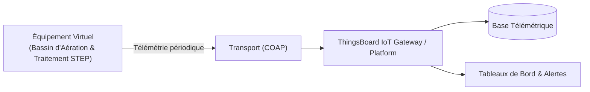

# Cas d'Usage Métier : Bassin d'Aération & Traitement STEP

> **Secteur d'Activité** : Infrastructures & Énergie  
> **Identifiant du Modèle** : `infra_water_treatment`  
> **Protocole Recommandé** : `COAP` | **Plateforme Cible** : ThingsBoard, Multi-Plateformes  
> **Icône Applicative** : `droplet`

---

## 1. Contexte & Enjeux Métier

Station d'épuration municipale et industrielle (boues activées). Contrôle de la biodégradation aérobie par asservissement de l'oxygène dissous et surveillance physico-chimique.

### Objectifs Opérationnels :
- Acquisition en temps réel des grandeurs physiques critiques sans latence.
- Surveillance continue et détection précoce des dérives ou pannes potentielles.
- Optimisation des consommations d'énergie et réduction des coûts d'exploitation et de maintenance.
- Traçabilité réglementaire et conformité aux standards de sécurité industrielle.

---

## 2. Architecture & Topologie de Communication

L'équipement virtuel `infra_water_treatment` s'interface directement avec ThingsBoard ou un broker intermédiaire selon les modalités suivantes :



- **Transport standard** : `COAP`
- **Topic MQTT / Endpoint HTTP / CoAP** :
  - **MQTT** : `v1/devices/me/telemetry` (télémétrie) et `v1/devices/me/attributes` (attributs)
  - **HTTP** : `POST /api/v1/{token}/telemetry`
  - **CoAP** : `coap://thingsboard:5683/api/v1/{token}/telemetry`

---

## 3. Dictionnaire Détaillé des Variables

| Clé (ID) | Grandeur Lisible | Type | Format | Unité | Période | Générateur / Plage | Rôle Métier & Description |
|---|---|---|---|---|---|---|---|
| `oxygene_dissous_mgl` | **Taux Oxygène Dissous (O₂)** | `telemetry` | `float` | `mg/l` | 3.0s | Sinusoïde [1.4, 3.2] mg/l | Concentration vitale pour les bactéries épuratrices |
| `potentiel_redox_mv` | **Potentiel d'Oxydoréduction (Redox)** | `telemetry` | `float` | `mV` | 4.0s | Gaussienne [-120, 180] mV | Indicateur de nitrification / dénitrification |
| `ph_eau` | **Acidité / Basicité pH** | `telemetry` | `float` | `pH` | 4.0s | Gaussienne [6.8, 7.6] pH | Équilibre acido-basique de l'effluent |
| `turbidite_ntu` | **Indice Turbidité Eau** | `telemetry` | `float` | `NTU` | 5.0s | Marche aléatoire [8, 42] | Teneur en matières en suspension (MES) |
| `debit_insufflation_nm3h` | **Débit Air Surpresseurs** | `telemetry` | `float` | `Nm³/h` | 3.0s | Triangle [400, 1200] Nm³/h | Volume d'air injecté par les diffuseurs poreux |

---

## 4. Schémas des Payloads JSON (ThingsBoard)

### 4.1 Télémétrie Périodique
```json
{
  "oxygene_dissous_mgl": 24.5,
  "potentiel_redox_mv": 24.5,
  "ph_eau": 24.5,
  "turbidite_ntu": 24.5,
  "debit_insufflation_nm3h": 24.5
}
```

### 4.2 Attributs d'État Partagés & Client
```json
{}
```

---

## 5. Scénarios d'Anomalies & Maintenance Prédictive

Le moteur du simulateur permet d'injecter des défaillances en direct (*Chaos Testing*) pour éprouver les règles d'alertes du serveur :

- **Pic ponctuel anormal (*Spike*)** : Simule un à-coup de pression, un choc mécanique ou une surtension transitoire.
- **Dérive continue (*Drift*)** : Simule l'encrassement progressif, le manque de lubrification ou une fuite d'étanchéité graduelle.
- **Gel de valeur (*Freeze*)** : Simule un blocage mécanique de capteur ou un convertisseur bloqué.
- **Silence radio (*Timeout*)** : Simule une perte d'alimentation du module ou une rupture de liaison télécoms.

> [!WARNING]
> **Cas de défaillance type** :  
> Chute brutale de l'oxygène dissous menaçant la faune bactérienne, dérive acide du pH liée à un effluent chimique.

---

## 6. Recommandations de Visualisation & Tableaux de Bord

Pour restituer la valeur métier de cet équipement sur ThingsBoard, les widgets suivants sont conseillés :

- Jauge O2 dissous avec régulation PID automatique
- Graphique Redox vs pH
- Bilan énergétique des surpresseurs d'air
