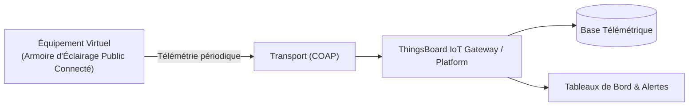

# Cas d'Usage Métier : Armoire d'Éclairage Public Connecté

> **Secteur d'Activité** : Villes Durables & Télécoms  
> **Identifiant du Modèle** : `city_lighting`  
> **Protocole Recommandé** : `COAP` | **Plateforme Cible** : ThingsBoard, Multi-Plateformes  
> **Icône Applicative** : `lightbulb`

---

## 1. Contexte & Enjeux Métier

Télégestion centralisée d'armoires urbaines d'éclairage. Pilotage de l'horloge astronomique, gradation nocturne (abaissement 50%), comptage d'énergie et sécurité des personnes.

### Objectifs Opérationnels :
- Acquisition en temps réel des grandeurs physiques critiques sans latence.
- Surveillance continue et détection précoce des dérives ou pannes potentielles.
- Optimisation des consommations d'énergie et réduction des coûts d'exploitation et de maintenance.
- Traçabilité réglementaire et conformité aux standards de sécurité industrielle.

---

## 2. Architecture & Topologie de Communication

L'équipement virtuel `city_lighting` s'interface directement avec ThingsBoard ou un broker intermédiaire selon les modalités suivantes :



- **Transport standard** : `COAP`
- **Topic MQTT / Endpoint HTTP / CoAP** :
  - **MQTT** : `v1/devices/me/telemetry` (télémétrie) et `v1/devices/me/attributes` (attributs)
  - **HTTP** : `POST /api/v1/{token}/telemetry`
  - **CoAP** : `coap://thingsboard:5683/api/v1/{token}/telemetry`

---

## 3. Dictionnaire Détaillé des Variables

| Clé (ID) | Grandeur Lisible | Type | Format | Unité | Période | Générateur / Plage | Rôle Métier & Description |
|---|---|---|---|---|---|---|---|
| `puissance_eclairage_kw` | **Puissance Circuit Éclairage** | `telemetry` | `float` | `kW` | 5.0s | Sinusoïde [2.5, 14.0] kW | Appel de charge du départ lampadaires |
| `niveau_gradation_pct` | **Niveau Gradation (Abaissement)** | `telemetry` | `integer` | `%` | 10.0s | Triangle [30, 100] % | Abaissement de puissance au cœur de la nuit |
| `courant_fuite_ma` | **Courant de Fuite Différentiel** | `telemetry` | `float` | `mA` | 5.0s | Gaussienne [12, 48] mA | Surveillance d'isolement électrique |
| `alerte_porte_ouverte` | **Contact d'Ouverture Porte** | `attribute` | `boolean` | `-` | 60.0s | Constante (False) | Détection d'effraction ou vandalisme |

---

## 4. Schémas des Payloads JSON (ThingsBoard)

### 4.1 Télémétrie Périodique
```json
{
  "puissance_eclairage_kw": 24.5,
  "niveau_gradation_pct": 42,
  "courant_fuite_ma": 24.5
}
```

### 4.2 Attributs d'État Partagés & Client
```json
{
  "alerte_porte_ouverte": false
}
```

---

## 5. Scénarios d'Anomalies & Maintenance Prédictive

Le moteur du simulateur permet d'injecter des défaillances en direct (*Chaos Testing*) pour éprouver les règles d'alertes du serveur :

- **Pic ponctuel anormal (*Spike*)** : Simule un à-coup de pression, un choc mécanique ou une surtension transitoire.
- **Dérive continue (*Drift*)** : Simule l'encrassement progressif, le manque de lubrification ou une fuite d'étanchéité graduelle.
- **Gel de valeur (*Freeze*)** : Simule un blocage mécanique de capteur ou un convertisseur bloqué.
- **Silence radio (*Timeout*)** : Simule une perte d'alimentation du module ou une rupture de liaison télécoms.

> [!WARNING]
> **Cas de défaillance type** :  
> Courant de fuite anormal (défaut d'isolement mettant les candélabres sous tension), intrusion porte armoire.

---

## 6. Recommandations de Visualisation & Tableaux de Bord

Pour restituer la valeur métier de cet équipement sur ThingsBoard, les widgets suivants sont conseillés :

- Carte des armoires d'éclairage avec statut
- Jauge de gradation nocturne
- Alerte de sécurité différentielle > 30 mA
