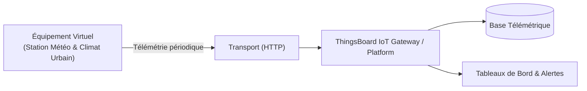

# Cas d'Usage Métier : Station Météo & Climat Urbain

> **Secteur d'Activité** : Villes Durables & Télécoms  
> **Identifiant du Modèle** : `city_weather`  
> **Protocole Recommandé** : `HTTP` | **Plateforme Cible** : ThingsBoard, Multi-Plateformes  
> **Icône Applicative** : `cloud-sun`

---

## 1. Contexte & Enjeux Métier

Réseau de micro-capteurs météorologiques pour l'adaptation au changement climatique. Identification des îlots de chaleur urbains (ICU), alertes orages et gestion des canicules.

### Objectifs Opérationnels :
- Acquisition en temps réel des grandeurs physiques critiques sans latence.
- Surveillance continue et détection précoce des dérives ou pannes potentielles.
- Optimisation des consommations d'énergie et réduction des coûts d'exploitation et de maintenance.
- Traçabilité réglementaire et conformité aux standards de sécurité industrielle.

---

## 2. Architecture & Topologie de Communication

L'équipement virtuel `city_weather` s'interface directement avec ThingsBoard ou un broker intermédiaire selon les modalités suivantes :



- **Transport standard** : `HTTP`
- **Topic MQTT / Endpoint HTTP / CoAP** :
  - **MQTT** : `v1/devices/me/telemetry` (télémétrie) et `v1/devices/me/attributes` (attributs)
  - **HTTP** : `POST /api/v1/{token}/telemetry`
  - **CoAP** : `coap://thingsboard:5683/api/v1/{token}/telemetry`

---

## 3. Dictionnaire Détaillé des Variables

| Clé (ID) | Grandeur Lisible | Type | Format | Unité | Période | Générateur / Plage | Rôle Métier & Description |
|---|---|---|---|---|---|---|---|
| `temp_ext` | **Température sous Abri** | `telemetry` | `float` | `°C` | 5.0s | Sinusoïde [14, 29] °C | Température normalisée de l'air ambiant |
| `vitesse_vent_kmh` | **Vitesse du Vent** | `telemetry` | `float` | `km/h` | 3.0s | Gaussienne [5, 45] km/h | Anémomètre girouette à coupelles |
| `humidite_ext` | **Hygrométrie Extérieure** | `telemetry` | `float` | `%` | 5.0s | Sinusoïde [35, 80] % | Humidité relative de l'air urbain |
| `indice_uv` | **Indice Rayonnement UV** | `telemetry` | `float` | `-` | 5.0s | Sinusoïde [0, 8.5] | Niveau d'exposition ultraviolet |

---

## 4. Schémas des Payloads JSON (ThingsBoard)

### 4.1 Télémétrie Périodique
```json
{
  "temp_ext": 24.5,
  "vitesse_vent_kmh": 24.5,
  "humidite_ext": 24.5,
  "indice_uv": 24.5
}
```

### 4.2 Attributs d'État Partagés & Client
```json
{}
```

---

## 5. Scénarios d'Anomalies & Maintenance Prédictive

Le moteur du simulateur permet d'injecter des défaillances en direct (*Chaos Testing*) pour éprouver les règles d'alertes du serveur :

- **Pic ponctuel anormal (*Spike*)** : Simule un à-coup de pression, un choc mécanique ou une surtension transitoire.
- **Dérive continue (*Drift*)** : Simule l'encrassement progressif, le manque de lubrification ou une fuite d'étanchéité graduelle.
- **Gel de valeur (*Freeze*)** : Simule un blocage mécanique de capteur ou un convertisseur bloqué.
- **Silence radio (*Timeout*)** : Simule une perte d'alimentation du module ou une rupture de liaison télécoms.

> [!WARNING]
> **Cas de défaillance type** :  
> Pic thermique estival créant un ICU nocturne, rafales de vent dépassant les seuils de sécurité municipale.

---

## 6. Recommandations de Visualisation & Tableaux de Bord

Pour restituer la valeur métier de cet équipement sur ThingsBoard, les widgets suivants sont conseillés :

- Station météo digitale complète
- Indicateur d'îlot de chaleur urbain (ICU)
- Historique pluviométrique et vent
