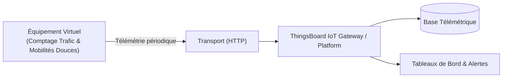

# Cas d'Usage Métier : Comptage Trafic & Mobilités Douces

> **Secteur d'Activité** : Villes Durables & Télécoms  
> **Identifiant du Modèle** : `city_traffic`  
> **Protocole Recommandé** : `HTTP` | **Plateforme Cible** : ThingsBoard, Multi-Plateformes  
> **Icône Applicative** : `car`

---

## 1. Contexte & Enjeux Métier

Caméras ou radars edge-AI de comptage multimodal (voitures, bus, vélos, trottinettes, piétons). Analyse des reports modaux et régulation adaptative des feux de signalisation.

### Objectifs Opérationnels :
- Acquisition en temps réel des grandeurs physiques critiques sans latence.
- Surveillance continue et détection précoce des dérives ou pannes potentielles.
- Optimisation des consommations d'énergie et réduction des coûts d'exploitation et de maintenance.
- Traçabilité réglementaire et conformité aux standards de sécurité industrielle.

---

## 2. Architecture & Topologie de Communication

L'équipement virtuel `city_traffic` s'interface directement avec ThingsBoard ou un broker intermédiaire selon les modalités suivantes :



- **Transport standard** : `HTTP`
- **Topic MQTT / Endpoint HTTP / CoAP** :
  - **MQTT** : `v1/devices/me/telemetry` (télémétrie) et `v1/devices/me/attributes` (attributs)
  - **HTTP** : `POST /api/v1/{token}/telemetry`
  - **CoAP** : `coap://thingsboard:5683/api/v1/{token}/telemetry`

---

## 3. Dictionnaire Détaillé des Variables

| Clé (ID) | Grandeur Lisible | Type | Format | Unité | Période | Générateur / Plage | Rôle Métier & Description |
|---|---|---|---|---|---|---|---|
| `debit_vehicules` | **Débit Véhicules Légers** | `telemetry` | `integer` | `véh/h` | 5.0s | Sinusoïde [120, 950] véh/h | Comptage automatique sur axe structurant |
| `debit_cyclistes` | **Passage Vélos & Mobilités Douces** | `telemetry` | `integer` | `vélos/h` | 5.0s | Sinusoïde [15, 180] vélos/h | Comptage sur piste cyclable sécurisée |
| `vitesse_moyenne_kmh` | **Vitesse Moyenne Mesurée** | `telemetry` | `float` | `km/h` | 3.0s | Gaussienne [32, 48] km/h | Vitesse cinétique réelle du flux |
| `alerte_congestion` | **Seuil de Congestion Dépassé** | `attribute` | `boolean` | `-` | 30.0s | Constante (False) | Déclenchement d'itinéraire de délestage |

---

## 4. Schémas des Payloads JSON (ThingsBoard)

### 4.1 Télémétrie Périodique
```json
{
  "debit_vehicules": 42,
  "debit_cyclistes": 42,
  "vitesse_moyenne_kmh": 24.5
}
```

### 4.2 Attributs d'État Partagés & Client
```json
{
  "alerte_congestion": false
}
```

---

## 5. Scénarios d'Anomalies & Maintenance Prédictive

Le moteur du simulateur permet d'injecter des défaillances en direct (*Chaos Testing*) pour éprouver les règles d'alertes du serveur :

- **Pic ponctuel anormal (*Spike*)** : Simule un à-coup de pression, un choc mécanique ou une surtension transitoire.
- **Dérive continue (*Drift*)** : Simule l'encrassement progressif, le manque de lubrification ou une fuite d'étanchéité graduelle.
- **Gel de valeur (*Freeze*)** : Simule un blocage mécanique de capteur ou un convertisseur bloqué.
- **Silence radio (*Timeout*)** : Simule une perte d'alimentation du module ou une rupture de liaison télécoms.

> [!WARNING]
> **Cas de défaillance type** :  
> Congestion routière avec effondrement de la vitesse moyenne, pic anormal de cyclistes en heure de pointe.

---

## 6. Recommandations de Visualisation & Tableaux de Bord

Pour restituer la valeur métier de cet équipement sur ThingsBoard, les widgets suivants sont conseillés :

- Répartition modale (Voitures vs Vélos vs Piétons)
- Vitesse moyenne et indice de fluidité
- Historique de fréquentation par tranche horaire
