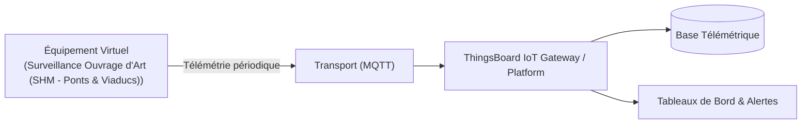

# Cas d'Usage Métier : Surveillance Ouvrage d'Art (SHM - Ponts & Viaducs)

> **Secteur d'Activité** : Villes Durables & Télécoms  
> **Identifiant du Modèle** : `city_structure_shm`  
> **Protocole Recommandé** : `MQTT` | **Plateforme Cible** : ThingsBoard, Multi-Plateformes  
> **Icône Applicative** : `git-commit`

---

## 1. Contexte & Enjeux Métier

Structural Health Monitoring (SHM) sur infrastructures critiques (ponts métalliques, viaducs béton, tunnels). Mesure d'inclinométrie, déformation mécanique sous charge et fatigue vibratoire.

### Objectifs Opérationnels :
- Acquisition en temps réel des grandeurs physiques critiques sans latence.
- Surveillance continue et détection précoce des dérives ou pannes potentielles.
- Optimisation des consommations d'énergie et réduction des coûts d'exploitation et de maintenance.
- Traçabilité réglementaire et conformité aux standards de sécurité industrielle.

---

## 2. Architecture & Topologie de Communication

L'équipement virtuel `city_structure_shm` s'interface directement avec ThingsBoard ou un broker intermédiaire selon les modalités suivantes :



- **Transport standard** : `MQTT`
- **Topic MQTT / Endpoint HTTP / CoAP** :
  - **MQTT** : `v1/devices/me/telemetry` (télémétrie) et `v1/devices/me/attributes` (attributs)
  - **HTTP** : `POST /api/v1/{token}/telemetry`
  - **CoAP** : `coap://thingsboard:5683/api/v1/{token}/telemetry`

---

## 3. Dictionnaire Détaillé des Variables

| Clé (ID) | Grandeur Lisible | Type | Format | Unité | Période | Générateur / Plage | Rôle Métier & Description |
|---|---|---|---|---|---|---|---|
| `inclinometrie_mrad` | **Inclinaison Piles / Tablier** | `telemetry` | `float` | `mrad` | 2.0s | Gaussienne [-1.2, 1.2] mrad | Capteur MEMS inclinométrique bi-axial haute précision |
| `ecartement_fissure_mm` | **Écartement Fissuromètre** | `telemetry` | `float` | `mm` | 5.0s | Marche aléatoire [1.42, 1.58] mm | Capteur potentiométrique ou LVDT |
| `deformation_microstrain` | **Contrainte Déformation (Jauge)** | `telemetry` | `float` | `µε` | 2.0s | Sinusoïde [-85, 140] µε | Jauges de contrainte sur poutres maîtresses |
| `frequence_propre_hz` | **Fréquence Fondamentale Propre** | `telemetry` | `float` | `Hz` | 5.0s | Gaussienne [2.15, 2.35] Hz | Analyse modale opérationnelle (OMA) |
| `temp_acier_beton` | **Température Interne Béton/Acier** | `telemetry` | `float` | `°C` | 10.0s | Sinusoïde [8, 26] °C | Compensation thermique des dilatations |

---

## 4. Schémas des Payloads JSON (ThingsBoard)

### 4.1 Télémétrie Périodique
```json
{
  "inclinometrie_mrad": 24.5,
  "ecartement_fissure_mm": 24.5,
  "deformation_microstrain": 24.5,
  "frequence_propre_hz": 24.5,
  "temp_acier_beton": 24.5
}
```

### 4.2 Attributs d'État Partagés & Client
```json
{}
```

---

## 5. Scénarios d'Anomalies & Maintenance Prédictive

Le moteur du simulateur permet d'injecter des défaillances en direct (*Chaos Testing*) pour éprouver les règles d'alertes du serveur :

- **Pic ponctuel anormal (*Spike*)** : Simule un à-coup de pression, un choc mécanique ou une surtension transitoire.
- **Dérive continue (*Drift*)** : Simule l'encrassement progressif, le manque de lubrification ou une fuite d'étanchéité graduelle.
- **Gel de valeur (*Freeze*)** : Simule un blocage mécanique de capteur ou un convertisseur bloqué.
- **Silence radio (*Timeout*)** : Simule une perte d'alimentation du module ou une rupture de liaison télécoms.

> [!WARNING]
> **Cas de défaillance type** :  
> Écartement irréversible d'une fissure de tablier, modification de la fréquence propre de résonance trahissant une perte de rigidité structurale.

---

## 6. Recommandations de Visualisation & Tableaux de Bord

Pour restituer la valeur métier de cet équipement sur ThingsBoard, les widgets suivants sont conseillés :

- Modèle 3D de l'ouvrage avec contraintes en couleur
- Fissuromètre digital haute sensibilité
- Spectrogramme de fréquence propre fondamentale
