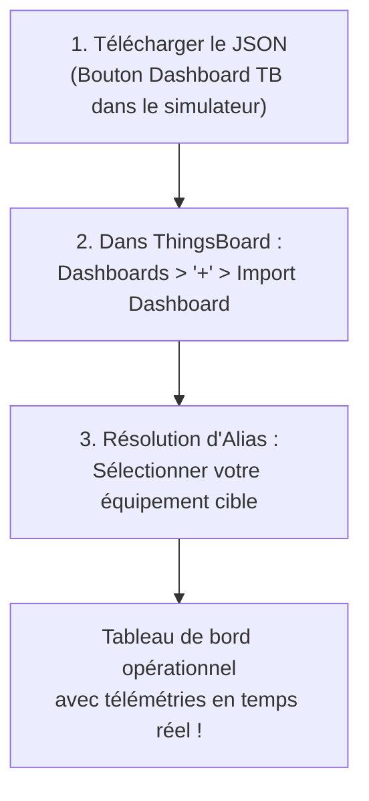

# Guide d'Utilisation : Tableaux de Bord SCADA ThingsBoard Préconfigurés

> **Compatibilité** : ThingsBoard 4.3 (version de référence), ThingsBoard CE/PE v3.x à v4.x+  
> **Type de Tableau de Bord** : SCADA / HMI Haute Performance (Normes ISA-101, ISO 10628, IEC 60617)  
> **Format** : Fichiers JSON officiels ThingsBoard Dashboard avec Pilotage Bidirectionnel (RPC & Shared Attributes)

---

## 1. Présentation Générale & Philosophie SCADA

Pour répondre aux exigences des environnements industriels, tertiaires et d'infrastructures, chaque équipement et cas d'usage dispose d'un **tableau de bord ThingsBoard de type SCADA (Supervisory Control And Data Acquisition)** complet, préconfiguré et **entièrement pilotable de manière bidirectionnelle**.

Chaque tableau de bord respecte les règles métier et conventions graphiques de la profession :
- **Synoptique SCADA Vectoriel Dédié (Mimic Display)** :
  - **Industrie & Thermique** : Schémas P&ID tuyauterie & instrumentation (ISO 10628) avec sens d'écoulement animé des fluides, rotors en mouvement (compresseurs, pompes, ventilateurs), cuves avec niveaux visuels et barillets de vapeur/air.
  - **Électricité & Réseaux** : Schémas unifilaires (SLD selon IEC 60617) représentant les arrivées HTA/BT, disjoncteurs ouverts/fermés, transformateurs et jeux de barres cuivre.
  - **Bâtiment & GTB** : Synoptiques aérauliques double flux avec registres de dosage, batteries chaudes/froides, filtres différentiels et caissons de mélange.
  - **Smart City & IoT** : Vues d'infrastructures réelles (mâts météo, candélabres avec gradation, fosses de relevage assainissement, baies télécoms N+1).
- **Tags d'Instrumentation en Temps Réel** : Les valeurs physiques critiques sont repérées directement sur les organes du schéma (sur le tuyau d'air, au niveau de la vanne, sur la génératrice, à l'entrée du disjoncteur) avec valeur numérique, unité et couleur d'état.
- **Pupitre d'Instrumentation & Jauges** : Jauges de processus industrielles avec zones de consigne (*Setpoint*) et seuils opérationnels.
- **Enregistreur de Tendance (*SCADA Historian & Trend Viewer*)** : Fenêtre glissante de 2 minutes en temps réel avec statistiques (min, max, moyenne, valeur courante).
- **Pupitre de Pilotage & Commandes Opérateur (Contrôle Interactif)** :
  - Interrupteurs rotatifs et boutons bascules (**Round Switch Controls**) pour les variables d'état (Marche/Arrêt, Mode Chaud/Froid, Forçage Dégivrage, Vannes ON/OFF, Déclencheurs de test).
  - Formulaires interactifs de saisie de consignes (**Update Attributes Form**) pour régler les ouvertures de registres (0-100%), pourcentages de modulation ou modes de fonctionnement.
- **Registre des Attributs & Paramètres Automate** : Synthèse des attributs de contrôle, modes (Auto / Manuel / Local / Distant) et grandeurs d'état.
- **Bannière d'Identification Sécurisée** : En-tête épuré intégrant le nom de l'équipement, l'identifiant technique, le protocole actif et un badge d'authentification sécurisée. Par mesure de cybersécurité (conforme CIS & OWASP), **l'Access Token n'est jamais divulgué ni affiché en clair sur l'écran**, protégeant vos identifiants lors de partages d'écrans ou de projections en salle de contrôle.
- **Thème Graphique Light & Haute Lisibilité (WCAG AA)** :
  - Palette claire professionnelle privilégiant les fonds blancs (`#FFFFFF`) et gris clair (`#F1F5F9`).
  - Textes et typographies en fort contraste sombre (`#0F172A` / `#475569`, ratio > 7:1) garantissant une lisibilité parfaite en salle de contrôle ou bureau éclairé.
  - Accentuation technique rouge vif (`#E2001A`) et codes couleurs normalisés (fluides froids en bleu `#0284C7`, thermiques en rouge `#DC2626`, électriques en ambre `#D97706`, environnement en vert `#059669`).
  - Strict respect de la neutralité visuelle (aucune marque déposée ni logo d'entreprise tiers dans les SVG).

---

## 2. Référentiel & Cohérence Métier des 32 Synoptiques SCADA Vectoriels

Chaque cas d'usage dispose de sa propre représentation vectorielle SVG animée, conçue selon les règles de l'art du métier concerné.

> [!IMPORTANT]
> **Cohérence Métier Garantie** :
> Chaque équipement est modélisé de façon stricte. Par exemple, la **Pompe à Chaleur Réversible** (`bldg_heatpump`) dispose d'un synoptique thermodynamique complet (compresseur Scroll inverter, vanne 4 voies d'inversion de cycle, échangeur à plaques et ventilateur axial) et ne doit jamais être confondue avec le **Poste de Relevage Assainissement** (`infra_water_pump`) qui possède sa propre fosse humide béton avec pompes submersibles d'eaux usées et refoulement STEP.

### 🏭 2.1 Secteur Industrie & Automatismes (8 cas d'usage)

| ID Modèle | Cas d'Usage Métier | Norme / Type SCADA | Description du Schéma Synoptique Dédié |
| :--- | :--- | :---: | :--- |
| `ind_compressor` | **Centrale d'Air Comprimé** | P&ID ISO 10628 | Filtre d'aspiration G4, compresseur bi-étagé à vis avec rotor animé (`#E2001A`), séparateur huile/air, réservoir tampon 1000L et ligne usine. |
| `ind_spindle` | **Broche d'Usinage & Moteur CNC** | Mimic ISA-101 | Cartouche de broche HSK-63, roulements céramiques avant/arrière, stator 24kW, chemise de refroidissement et accéléromètre de vibration RMS. |
| `ind_chiller` | **Groupe Froid Industriel (Chiller)** | P&ID Frigorifique | Circuit fermé R134a, compresseur à vis avec rotor animé, évaporateur eau glacée 7/12°C, condenseur et boucle de départ/retour usine. |
| `ind_conveyor` | **Ligne de Convoyage & Robotique** | Mimic Manutention | Châssis convoyeur à rouleaux motorisés, pièces en transit, cellule photoélectrique de détection, motoréducteur 5.5kW avec variateur VFD. |
| `ind_cold_room` | **Chambre Froide Négative (-20°C)** | CVC / Froid Négatif | Enceinte isotherme (panneaux PIR 150mm), évaporateur plafonnier avec ventilateurs, résistances de dégivrage, palettes surgelées et capteur de porte. |
| `ind_steam_boiler` | **Chaudière Industrielle Vapeur** | P&ID Vapeur HP | Bâche alimentaire d'eau, pompe HP, corps chaudière tube de fumées avec brûleur gaz modulant, ciel de vapeur et barillet collecteur usine. |
| `ind_cleanroom_cta` | **Salle Blanche & CTA Stérile (ISO)** | GTB Salle Propre | Enceinte stérile ISO 14644-1, plafond soufflant flux laminaire HEPA H14 (99.995%), sas matériel airlock interverrouillé et compteur optique laser de particules. |
| `ind_thermal_furnace` | **Four Traitement Thermique** | Pyrométrie Industrielle | Enceinte réfractaire 3 zones (Zone 1 Préchauffe, Zone 2 Haute Température, Zone 3 Recuit), rampe brûleurs gaz et flammes modulées. |

### 🏢 2.2 Secteur Bâtiment & Tertiaire (8 cas d'usage)

| ID Modèle | Cas d'Usage Métier | Norme / Type SCADA | Description du Schéma Synoptique Dédié |
| :--- | :--- | :---: | :--- |
| `bldg_cta` | **Centrale Traitement d'Air (CTA)** | GTB DIN 1946 | Voie soufflage air neuf avec registre, filtre F7, batteries chaud/froid, ventilateur Plug-Fan EC animé et voie reprise extraction. |
| `bldg_tgbt` | **TGBT & Compteur Multi-Fluides** | SLD IEC 60617 | Arrivée HTA/BT 400V, disjoncteur général DGBT Masterpact, jeu de barres cuivre 1600A, départs divisionnaires CVC, IT/Onduleur et DALI. |
| `bldg_qai` | **Station Qualité d'Air Intérieur (QAI)** | Bâtiment BREEAM / WELL | Boîtier station confort, capteur CO2 NDIR infrarouge, capteur laser particules fines PM2.5 et capteur semi-conducteur MOx COV totaux. |
| `bldg_heatpump` | **Pompe à Chaleur Réversible (PAC)** | CVC Thermodynamique | **Unité extérieure R32, compresseur Inverter Scroll, vanne 4 voies d'inversion de cycle, échangeur à plaques hydro (module intérieur) et ventilateur hélicoïde.** |
| `bldg_fire_ssi` | **Centrale Sécurité Incendie (SSI)** | SMSI NF S 61-931 | Centrale ECS / CMSI, boucle détecteur optique de fumée, clapets coupe-feu motorisés et tourelle d'extraction de désenfumage 400°C/2h. |
| `bldg_dali_lighting` | **Gestion d'Éclairage DALI-2** | DALI-2 / GTB | Passerelle de commande, bus 2 fils DALI-2 (64 adresses), luminaires LED graduables avec faisceau lumineux et détecteur PIR/Luxmètre. |
| `bldg_thermal_meter` | **Compteur d'Énergie Thermique** | Calorimétrie EN 1434 | Conduite aller eau chaude avec sonde PT100, conduite retour avec débitmètre ultrasonique, sonde retour et intégrateur calorimétrique $Q = m \cdot Cp \cdot \Delta T$. |
| `bldg_access_flow` | **Contrôle d'Accès & Flux Bâtiment** | Sécurité Sûreté | Hall d'accueil, portillons motorisés rapides d'accès (*Speed Gates*) entrée/sortie, lecteurs RFID et caméra stéréoscopique 3D de comptage des flux. |

### ⚡ 2.3 Secteur Infrastructures & Réseaux (8 cas d'usage)

| ID Modèle | Cas d'Usage Métier | Norme / Type SCADA | Description du Schéma Synoptique Dédié |
| :--- | :--- | :---: | :--- |
| `infra_transfo_hta` | **Transformateur HTA/BT** | Électrotechnique HTA | Cuve à ailettes refroidie par huile diélectrique, traversées HTA 20kV, bornes BT 400V et relais combiné de protection DGPT2 (Gaz, Pression, Température). |
| `infra_solar_pv` | **Onduleur Solaire Photovoltaïque** | Photovoltaïque IEC | Champ de modules solaires 500kWc, pyranomètre, ligne DC 820V, onduleur central MPPT bi-étagé et transformateur d'injection réseau HTA. |
| `infra_irve_charger` | **Borne de Recharge IRVE Ultra-Rapide** | Électromobilité DC | Borne DC 150kW avec écran tactile et lecteur RFID, câble combo CCS2 à refroidissement liquide relié à la silhouette du véhicule électrique. |
| `infra_water_pump` | **Poste de Relevage Assainissement** | Génie Civil STEP | **Fosse humide béton pour eaux usées, double pompe submersible P1/P2, sonde ultrasonique de niveau de bâche et conduite PEHD de refoulement vers la STEP.** |
| `infra_wind_turbine` | **Aérogénérateur / Éolienne MW** | Éolien IEC 61400 | Mât tubulaire béton/acier, nacelle 3MW avec anémomètre, rotor tripale à pales animées et transmission génératrice. |
| `infra_bess_storage` | **Stockage Batteries BESS (2 MWh)** | Stockage Réseau | Conteneur 40ft climatisé, racks modulaires de cellules batteries LFP avec BMS et convertisseur réversible PCS 4 quadrants bi-directionnel AC/DC. |
| `infra_rail_switch` | **Aiguillage Ferroviaire (ADV)** | Signalisation Ferroviaire | Voie principale et voie déviée avec aiguilles mobiles, moteur électromécanique à contrôle de tringle et résistances de réchauffage anti-gel des rails. |
| `infra_water_treatment` | **Bassin d'Aération & Traitement STEP** | Épuration Biologique | Bassin d'aération boues activées avec rampe de micro-diffuseurs d'air bullé, sonde optique à oxygène dissous LDO et sonde pH/Redox. |

### 🏙️ 2.4 Secteur Villes Intelligentes & Télécoms (8 cas d'usage)

| ID Modèle | Cas d'Usage Métier | Norme / Type SCADA | Description du Schéma Synoptique Dédié |
| :--- | :--- | :---: | :--- |
| `city_lighting` | **Armoire d'Éclairage Public** | Smart Lighting Urbain | Armoire de télégestion sur voirie avec horloge astronomique, ligne souterraine d'alimentation et candélabres LED à faisceau lumineux graduable. |
| `city_weather` | **Station Météo & Climat Urbain** | Météorologie Urbaine | Mât instrumenté avec anémomètre girouette ultrasonique, capteur pyranomètre UV, abri thermo-hygrométrique ventilé et pluviomètre à augets. |
| `telecom_shelter` | **Shelter Télécoms / Nœud Fibre** | Télécoms & Data Center | Enceinte shelter sécurisée, baies de routeurs IP et OLT fibre 19", onduleur UPS 40kVA double conversion et climatisation de précision N+1 redondante. |
| `city_traffic` | **Comptage Trafic & Mobilités** | Gestion de Trafic Urbain | Chaussée routière VL amont/aval, piste cyclable verte normée, boucles électromagnétiques au sol, portique radar Doppler et feu tricolore de régulation. |
| `city_waste_bin` | **Conteneur Déchets & PAV Connecté** | Smart Waste / Propreté | Borne d'apport volontaire hors sol, cuve enterrée 4m³ avec niveau volumique, sonde ultrasonique haute précision et alarme thermique/incendie. |
| `city_smart_irrigation` | **Arrosage Intelligent Espaces Verts** | Tensiométrie & Espaces Verts | Espace vert gazonné, sonde tensiométrique multi-profondeurs (-10cm), électrovanne motorisée 24V et tuyères d'arrosage déployées avec jet d'eau. |
| `city_acoustic_sensor` | **Sonde Acoustique & Bruit Urbain** | Nuisances / IEC 61672 | Microphone de mesure environnemental Classe 1 avec boule anti-vent, panneau solaire autonome et processeur DSP d'analyse spectrale par tiers d'octave. |
| `city_structure_shm` | **Surveillance Ouvrage d'Art (SHM)** | Génie Civil / Auscultation | Tablier et piles de pont en béton précontraint, fissuromètre électronique à corde vibrante (mm), inclinomètre bi-axial MEMS et jauges de déformation. |

---

## 3. Deux Méthodes pour Télécharger votre Dashboard

### Méthode 1 : Téléchargement Direct depuis l'Équipement Instancié (Recommandé)
Lorsque vous avez créé un équipement virtuel dans le simulateur (par exemple avec votre vrai token ThingsBoard) :
1. Dans l'interface web du simulateur, repérez la carte de votre équipement.
2. Dans la barre d'actions supérieure, cliquez sur le bouton **`Dashboard TB`** (icône bleu ciel).
3. Le simulateur génère et télécharge immédiatement un fichier `dashboard_tb_<id_equipement>.json` contenant :
   - Le nom exact de votre équipement.
   - Votre **Access Token ThingsBoard**.
   - La liste exhaustive de toutes ses grandeurs et formules couplées.

### Méthode 2 : Téléchargement depuis la Bibliothèque ou le Catalogue
- **Depuis l'IHM** : Dans le menu *Catalogue des Modèles*, chaque fiche dispose d'un bouton d'accès rapide au dashboard ThingsBoard modèle.
- **Depuis le Répertoire Local** : Tous les cas d'usage sont disponibles dans le dossier [`dashboards/thingsboard/`](file:///home/pierre/Projets/iot-data-simulator/dashboards/thingsboard/), classés par secteur :
  - `01_industrie/` (Centrale d'air comprimé, Broche d'usinage, Groupe froid, Four, etc.)
  - `02_tertiaire/` (CTA, TGBT, Pompe à chaleur, SSI incendie, QAI, etc.)
  - `03_infrastructures/` (Transformateur HTA/BT, Onduleur Solaire, Bornes IRVE, Éolienne, STEP, etc.)
  - `04_villes_telecoms/` (Éclairage public, Station météo, Shelter télécoms, etc.)

---

## 4. Procédure d'Importation dans ThingsBoard (3 Étapes)



### Étape 1 : Ouvrir la gestion des tableaux de bord
Connectez-vous à votre interface ThingsBoard, puis dans le menu latéral gauche, cliquez sur **Tableaux de bord (Dashboards)**.

### Étape 2 : Importer le fichier JSON
1. En haut à droite de l'écran, cliquez sur le bouton rond **`+`**.
2. Dans le menu contextuel, choisissez **Importer le tableau de bord (Import Dashboard)**.
3. Glissez-déposez le fichier `.json` téléchargé ou sélectionnez-le via l'explorateur de fichiers.

### Étape 3 : Résoudre l'alias d'entité
ThingsBoard analyse le fichier et ouvre la boîte de dialogue **« Résolution des alias d'entités »** :
1. L'alias porte le nom de votre équipement.
2. Dans la colonne *« Entité »*, sélectionnez dans le menu déroulant votre équipement ThingsBoard (créé au préalable avec l'Access Token correspondant).
3. Cliquez sur **Enregistrer** ou **Ajouter**.

---

## 5. Pilotage Bidirectionnel & Commandes Opérateur (ThingsBoard 4.3)

Chaque tableau de bord intègre désormais des composants de **pilotage interactif bidirectionnel** permettant à l'opérateur de modifier le comportement des équipements simulés directement depuis l'écran de supervision ThingsBoard :

```
+-----------------------------------------------------------------------------------+
| Télémétries en Temps Réel (Chart 16x8)   | [O] Pilotage - Mode Chaud (Switch 8x4)  |
|                                          +----------------------------------------+
|                                          | Attributs & États (Table 8x4)          |
+-----------------------------------------------------------------------------------+
```

### 5.1 Interrupteurs de Commande (*Single Switch Controls* sur Attributs Partagés)
- **Fonctionnement** : Pour chaque variable booléenne d'état ou de consigne (ex: *Mode Chaud* pour la pompe à chaleur, *État de Marche* pour le compresseur, *Ouverture Électrovanne* pour l'arrosage, *Contact Porte* pour la chambre froide, *Alerte Congestion* pour le trafic), un commutateur moderne **`system.single_switch`** (Action Widget) est positionné sur le tableau de bord.
- **Action Opérateur** : Un simple clic sur l'interrupteur bascule l'état (ON ↔ OFF).
- **Boucle de rétroaction en direct (Attributs Partagés `SHARED_SCOPE`)** :
  1. ThingsBoard écrit directement la modification dans les Attributs Partagés (`SHARED_SCOPE` via `SET_ATTRIBUTE`). Cette opération est instantanée en base (< 50 ms) et ne dépend pas du routage de la Root Rule Chain, éliminant tout risque d'erreur *504 Gateway Timeout*.
  2. Le simulateur IoT, à l'écoute en continu (soit via le topic MQTT `v1/devices/me/attributes`, soit via le Long-Polling HTTP `GET /api/v1/{token}/attributes/updates?timeout=20000`), intercepte la modification en temps réel.
  3. Le simulateur applique la nouvelle consigne avec forçage manuel (`manual_override = True`), acquitte l'attribut client de confirmation sur ThingsBoard et propage la mise à jour par WebSocket sur l'IHM locale sans rechargement de page.

### 5.2 Formulaires de Consignes & Paramètres (*Input Widgets*)
- Pour les grandeurs continues ou énumérées (ex: *Ouverture Registre Air Neuf %* sur la CTA, *Position Aiguillage* ferroviaire, *Statut Prise IRVE*), un widget de saisie permet de modifier la consigne et de l'appliquer via le bouton **`Valider`**.
- La nouvelle consigne est immédiatement transmise au simulateur qui adapte ses calculs mathématiques et ses dépendances physiques.

### 5.3 Répertoire des 18 Contrôles & Attributs Pilotables du Catalogue

| Secteur | Équipement (`preset_id`) | Attribut / Variable | Type & Widget | Méthode RPC / Topic | Effet Métier sur la Simulation |
| :--- | :--- | :--- | :--- | :--- | :--- |
| **Industrie** | `ind_compressor` | État de Marche (`etat_marche`) | Booléen (`round_switch`) | `set_etat_marche` | Démarrage / arrêt du compresseur, montée en pression réseau |
| **Industrie** | `ind_cold_room` | Porte Ouverte (`porte_ouverte`) | Booléen (`round_switch`) | `set_porte_ouverte` | Rupture pont thermique, élévation de température |
| **Industrie** | `ind_cold_room` | Statut Dégivrage (`statut_degivrage`) | Booléen (`round_switch`) | `set_statut_degivrage` | Enclenchement résistance de dégivrage évaporateur |
| **Industrie** | `ind_cleanroom_cta` | Alarme Dépressurisation (`alarme_depressurisation`) | Booléen (`round_switch`) | `set_alarme_depressurisation` | Simulation rupture cascade de surpression stérile |
| **Tertiaire** | `bldg_cta` | Ouverture Registre (`registre_air_neuf`) | Entier (`update_multiple_attributes`) | `v1/devices/me/attributes` | Débit d'air neuf et apport thermique extérieur |
| **Tertiaire** | `bldg_heatpump` | Mode Chaud (`mode_chaud`) | Booléen (`round_switch`) | `set_mode_chaud` | Inversion cycle thermodynamique (Chaud 45°C / Froid 7°C) |
| **Tertiaire** | `bldg_fire_ssi` | Déclencheur Manuel (`declencheur_manuel`) | Booléen (`round_switch`) | `set_declencheur_manuel` | Alarme générale SSI et scénario évacuation |
| **Tertiaire** | `bldg_fire_ssi` | Clapets Coupe-Feu (`statut_clapets_coupe_feu`) | Chaîne (`update_multiple_attributes`) | `v1/devices/me/attributes` | Position d'asservissement des DAS coupe-feu |
| **Tertiaire** | `bldg_access_flow` | Issues Secours Verrouillées (`issues_secours_verrouillees`) | Booléen (`round_switch`) | `set_issues_secours_verrouillees` | Verrouillage électromagnétique des issues |
| **Infrastructure** | `infra_transfo_hta` | Alarme DGPT2 (`alarme_dgpt2`) | Booléen (`round_switch`) | `set_alarme_dgpt2` | Alerte thermique & gaz sur transformateur diélectrique |
| **Infrastructure** | `infra_irve_charger` | Statut Prise T2 (`statut_connecteur`) | Chaîne (`update_multiple_attributes`) | `v1/devices/me/attributes` | Présence véhicule branché / charge en cours |
| **Infrastructure** | `infra_water_pump` | Alarme Débordement (`alarme_debordement`) | Booléen (`round_switch`) | `set_alarme_debordement` | Sécurité niveau haut poste de relèvement |
| **Infrastructure** | `infra_bess_storage` | Santé Batterie SoH (`soh_pct`) | Flottant (`update_multiple_attributes`) | `v1/devices/me/attributes` | État d'usure et dégradation de capacité BESS |
| **Infrastructure** | `infra_rail_switch` | Présence Essieu (`presence_essieu`) | Booléen (`round_switch`) | `set_presence_essieu` | Pédale d'occupation de canton ferroviaire |
| **Infrastructure** | `infra_rail_switch` | Position Aiguille (`position_aiguille`) | Chaîne (`update_multiple_attributes`) | `v1/devices/me/attributes` | Contrôle d'orientation et verrou mécanique |
| **Smart City** | `city_lighting` | Alerte Porte Armoire (`alerte_porte_ouverte`) | Booléen (`round_switch`) | `set_alerte_porte_ouverte` | Anti-intrusion / contact de baie candélabres |
| **Smart City** | `telecom_shelter` | Détection Inondation (`detection_inondation`) | Booléen (`round_switch`) | `set_detection_inondation` | Sonde de fuite au sol shelter télécom |
| **Smart City** | `city_traffic` | Alerte Congestion (`alerte_congestion`) | Booléen (`round_switch`) | `set_alerte_congestion` | Déclenchement scénario régulation de feux |
| **Smart City** | `city_waste_bin` | Alerte Incendie Bac (`alerte_incendie`) | Booléen (`round_switch`) | `set_alerte_incendie` | Capteur pyrométrique / fumée dans conteneur |
| **Smart City** | `city_waste_bin` | Alerte Basculement (`alerte_basculement`) | Booléen (`round_switch`) | `set_alerte_basculement` | Capteur inclinaison / vandalisme PAV |
| **Smart City** | `city_smart_irrigation` | Électrovanne Secteur (`vanne_secteur_ouverte`) | Booléen (`round_switch`) | `set_vanne_secteur_ouverte` | Ouverture circuit d'arrosage automatique |
| **Smart City** | `city_acoustic_sensor` | Seuil Bruit Nocturne (`depassement_seuil_nocturne`) | Booléen (`round_switch`) | `set_depassement_seuil_nocturne` | Alarme dépassement dB(A) riverains |

---

## 6. Dépannage & Bonnes Pratiques

- **Les widgets affichent `No data`** :
  - Vérifiez que la simulation est bien active dans le simulateur (indicateur vert *Simulation en cours*).
  - Vérifiez dans ThingsBoard (onglet *Dernière télémétrie* de l'équipement) que les données arrivent bien.
  - Si vous utilisez HTTP sur un port protégé (ex: Cloudflare port 443), assurez-vous que le protocole de l'équipement dans le simulateur est bien réglé sur `HTTP`.
- **Changement de Token** :
  - Si vous régénérez le Token sur ThingsBoard, mettez simplement à jour l'équipement dans le simulateur via le bouton *Éditer*, puis retéléchargez le dashboard si vous souhaitez garder la fiche d'information à jour.
