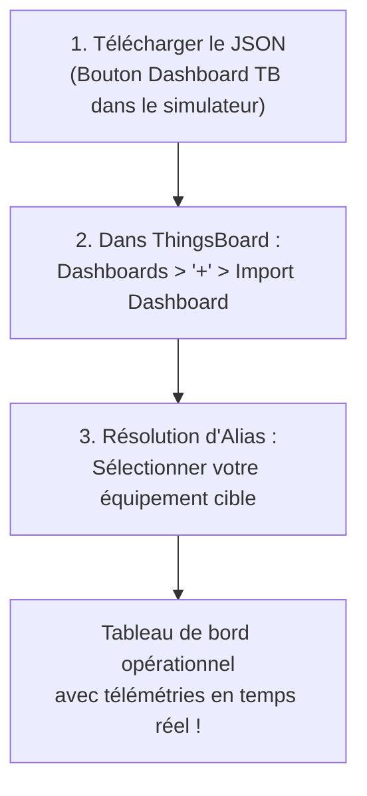

# Guide d'Utilisation : Tableaux de Bord ThingsBoard Préconfigurés

> **Compatibilité** : ThingsBoard Community Edition (CE) et Professional Edition (PE) versions 3.x à 3.8+  
> **Format** : Fichiers JSON officiels ThingsBoard Dashboard

---

## 1. Présentation Générale

Pour accélérer la mise en service et faciliter la supervision des flux IoT générés par le simulateur, chaque équipement et chaque cas d'usage dispose d'un **tableau de bord ThingsBoard complet et préconfiguré**.

Ce tableau de bord s'adapte automatiquement aux grandeurs physiques de l'équipement :
- **En-tête & Informations Connexion** : Affiche le nom de l'équipement, son identifiant technique, le protocole (`MQTT`, `HTTP`, `CoAP`), la cadence d'envoi et **l'Access Token ThingsBoard** configuré.
- **Jauges Numériques Instantanées** : Visualisation en temps réel des grandeurs physiques analogiques avec échelles et seuils adaptés (`°C`, `bar`, `kW`, `m³/h`, etc.).
- **Graphique Temporel Multi-Courbes (*Timeseries Chart*)** : Fenêtre glissante de 2 minutes en temps réel avec statistiques (min, max, moyenne, valeur courante).
- **Tableau des Attributs & États** : Synthèse des attributs de contrôle et grandeurs d'état.

---

## 2. Deux Méthodes pour Télécharger votre Dashboard

### Méthode 1 : Téléchargement Direct depuis l'Équipement Instancié (Recommandé)
Lorsque vous avez créé un équipement virtuel dans le simulateur (par exemple avec votre vrai token ThingsBoard) :
1. Dans l'interface web du simulateur, repérez la carte de votre équipement.
2. Dans la barre d'actions supérieure, cliquez sur le bouton **`Dashboard TB`** (icône bleu ciel).
3. Le simulateur génère et télécharge immédiatement un fichier `dashboard_tb_<id_equipement>.json` contenant :
   - Le nom exact de votre équipement.
   - Votre **Access Token ThingsBoard**.
   - La liste exhaustive de toutes ses grandeurs et formules couplées.

### Méthode 2 : Téléchargement depuis la Bibliothèque ou le Catalogue
- **Depuis l'IHM** : Dans le menu *Catalogue des Modèles*, chaque fiche dispose d'un bouton d'accès rapide au dashboard ThingsBoard modèle.
- **Depuis le Répertoire Local** : Tous les cas d'usage sont disponibles dans le dossier [`dashboards/thingsboard/`](file:///home/pierre/Projets/iot-data-simulator/dashboards/thingsboard/), classés par secteur :
  - `01_industrie/` (Centrale d'air comprimé, Broche d'usinage, Groupe froid, Four, etc.)
  - `02_tertiaire/` (CTA, TGBT, Pompe à chaleur, SSI incendie, QAI, etc.)
  - `03_infrastructures/` (Transformateur HTA/BT, Onduleur Solaire, Bornes IRVE, Éolienne, STEP, etc.)
  - `04_villes_telecoms/` (Éclairage public, Station météo, Shelter télécoms, etc.)

---

## 3. Procédure d'Importation dans ThingsBoard (3 Étapes)

### Étape 1 : Ouvrir la gestion des tableaux de bord
Connectez-vous à votre interface ThingsBoard, puis dans le menu latéral gauche, cliquez sur **Tableaux de bord (Dashboards)**.

### Étape 2 : Importer le fichier JSON
1. En haut à droite de l'écran, cliquez sur le bouton rond **`+`**.
2. Dans le menu contextuel, choisissez **Importer le tableau de bord (Import Dashboard)**.
3. Glissez-déposez le fichier `.json` téléchargé ou sélectionnez-le via l'explorateur de fichiers.

### Étape 3 : Résoudre l'alias d'entité
ThingsBoard analyse le fichier et ouvre la boîte de dialogue **« Résolution des alias d'entités »** :
1. L'alias porte le nom de votre équipement.
2. Dans la colonne *« Entité »*, sélectionnez dans le menu déroulant votre équipement ThingsBoard (créé au préalable avec l'Access Token correspondant).
3. Cliquez sur **Enregistrer** ou **Ajouter**.

---

## 4. Dépannage & Bonnes Pratiques

- **Les widgets affichent `No data`** :
  - Vérifiez que la simulation est bien active dans le simulateur (indicateur vert *Simulation en cours*).
  - Vérifiez dans ThingsBoard (onglet *Dernière télémétrie* de l'équipement) que les données arrivent bien.
  - Si vous utilisez HTTP sur un port protégé (ex: Cloudflare port 443), assurez-vous que le protocole de l'équipement dans le simulateur est bien réglé sur `HTTP`.
- **Changement de Token** :
  - Si vous régénérez le Token sur ThingsBoard, mettez simplement à jour l'équipement dans le simulateur via le bouton *Éditer*, puis retéléchargez le dashboard si vous souhaitez garder la fiche d'information à jour.
