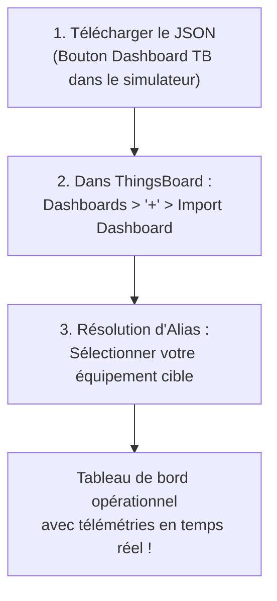

# Guide d'Utilisation : Tableaux de Bord SCADA ThingsBoard Préconfigurés

> **Compatibilité** : ThingsBoard Community Edition (CE) et Professional Edition (PE) versions 3.x à 3.8+  
> **Type de Tableau de Bord** : SCADA / HMI Haute Performance (Normes ISA-101, ISO 10628, IEC 60617)  
> **Format** : Fichiers JSON officiels ThingsBoard Dashboard

---

## 1. Présentation Générale & Philosophie SCADA

Pour répondre aux exigences des environnements industriels, tertiaires et d'infrastructures, chaque équipement et cas d'usage dispose d'un **tableau de bord ThingsBoard de type SCADA (Supervisory Control And Data Acquisition)** complet et préconfiguré.

Chaque tableau de bord respecte les règles métier et conventions graphiques de la profession :
- **Synoptique SCADA Vectoriel Dédié (Mimic Display)** :
  - **Industrie & Thermique** : Schémas P&ID tuyauterie & instrumentation (ISO 10628) avec sens d'écoulement animé des fluides, rotors en mouvement (compresseurs, pompes, ventilateurs), cuves avec niveaux visuels et barillets de vapeur/air.
  - **Électricité & Réseaux** : Schémas unifilaires (SLD selon IEC 60617) représentant les arrivées HTA/BT, disjoncteurs ouverts/fermés, transformateurs et jeux de barres cuivre.
  - **Bâtiment & GTB** : Synoptiques aérauliques double flux avec registres de dosage, batteries chaudes/froides, filtres différentiels et caissons de mélange.
  - **Smart City & IoT** : Vues d'infrastructures réelles (mâts météo, candélabres avec gradation, fosses de relevage assainissement, baies télécoms N+1).
- **Tags d'Instrumentation en Temps Réel** : Les valeurs physiques critiques sont repérées directement sur les organes du schéma (sur le tuyau d'air, au niveau de la vanne, sur la génératrice, à l'entrée du disjoncteur) avec valeur numérique, unité et couleur d'état.
- **Pupitre d'Instrumentation & Jauges** : Jauges de processus industrielles avec zones de consigne (*Setpoint*) et seuils opérationnels.
- **Enregistreur de Tendance (*SCADA Historian & Trend Viewer*)** : Fenêtre glissante de 2 minutes en temps réel avec statistiques (min, max, moyenne, valeur courante).
- **Registre des Attributs & Paramètres Automate** : Synthèse des attributs de contrôle, modes (Auto / Manuel / Local / Distant) et grandeurs d'état.
- **Bannière d'Identification & Token ThingsBoard** : En-tête sécurisé intégrant le nom de l'équipement, l'identifiant technique, le protocole et **votre vrai Access Token ThingsBoard**.
- **Thème Graphique Light & Haute Lisibilité (WCAG AA)** :
  - Palette claire professionnelle privilégiant les fonds blancs (`#FFFFFF`) et gris clair (`#F1F5F9`).
  - Textes et typographies en fort contraste sombre (`#0F172A` / `#475569`, ratio > 7:1) garantissant une lisibilité parfaite en salle de contrôle ou bureau éclairé.
  - Accentuation technique rouge vif (`#E2001A`) et codes couleurs normalisés (fluides froids en bleu `#0284C7`, thermiques en rouge `#DC2626`, électriques en ambre `#D97706`, environnement en vert `#059669`).
  - Strict respect de la neutralité visuelle (aucune marque déposée ni logo d'entreprise tiers dans les SVG).

---

## 2. Deux Méthodes pour Télécharger votre Dashboard

### Méthode 1 : Téléchargement Direct depuis l'Équipement Instancié (Recommandé)
Lorsque vous avez créé un équipement virtuel dans le simulateur (par exemple avec votre vrai token ThingsBoard) :
1. Dans l'interface web du simulateur, repérez la carte de votre équipement.
2. Dans la barre d'actions supérieure, cliquez sur le bouton **`Dashboard TB`** (icône bleu ciel).
3. Le simulateur génère et télécharge immédiatement un fichier `dashboard_tb_<id_equipement>.json` contenant :
   - Le nom exact de votre équipement.
   - Votre **Access Token ThingsBoard**.
   - La liste exhaustive de toutes ses grandeurs et formules couplées.

### Méthode 2 : Téléchargement depuis la Bibliothèque ou le Catalogue
- **Depuis l'IHM** : Dans le menu *Catalogue des Modèles*, chaque fiche dispose d'un bouton d'accès rapide au dashboard ThingsBoard modèle.
- **Depuis le Répertoire Local** : Tous les cas d'usage sont disponibles dans le dossier [`dashboards/thingsboard/`](file:///home/pierre/Projets/iot-data-simulator/dashboards/thingsboard/), classés par secteur :
  - `01_industrie/` (Centrale d'air comprimé, Broche d'usinage, Groupe froid, Four, etc.)
  - `02_tertiaire/` (CTA, TGBT, Pompe à chaleur, SSI incendie, QAI, etc.)
  - `03_infrastructures/` (Transformateur HTA/BT, Onduleur Solaire, Bornes IRVE, Éolienne, STEP, etc.)
  - `04_villes_telecoms/` (Éclairage public, Station météo, Shelter télécoms, etc.)

---

## 3. Procédure d'Importation dans ThingsBoard (3 Étapes)

### Étape 1 : Ouvrir la gestion des tableaux de bord
Connectez-vous à votre interface ThingsBoard, puis dans le menu latéral gauche, cliquez sur **Tableaux de bord (Dashboards)**.

### Étape 2 : Importer le fichier JSON
1. En haut à droite de l'écran, cliquez sur le bouton rond **`+`**.
2. Dans le menu contextuel, choisissez **Importer le tableau de bord (Import Dashboard)**.
3. Glissez-déposez le fichier `.json` téléchargé ou sélectionnez-le via l'explorateur de fichiers.

### Étape 3 : Résoudre l'alias d'entité
ThingsBoard analyse le fichier et ouvre la boîte de dialogue **« Résolution des alias d'entités »** :
1. L'alias porte le nom de votre équipement.
2. Dans la colonne *« Entité »*, sélectionnez dans le menu déroulant votre équipement ThingsBoard (créé au préalable avec l'Access Token correspondant).
3. Cliquez sur **Enregistrer** ou **Ajouter**.

---

## 4. Dépannage & Bonnes Pratiques

- **Les widgets affichent `No data`** :
  - Vérifiez que la simulation est bien active dans le simulateur (indicateur vert *Simulation en cours*).
  - Vérifiez dans ThingsBoard (onglet *Dernière télémétrie* de l'équipement) que les données arrivent bien.
  - Si vous utilisez HTTP sur un port protégé (ex: Cloudflare port 443), assurez-vous que le protocole de l'équipement dans le simulateur est bien réglé sur `HTTP`.
- **Changement de Token** :
  - Si vous régénérez le Token sur ThingsBoard, mettez simplement à jour l'équipement dans le simulateur via le bouton *Éditer*, puis retéléchargez le dashboard si vous souhaitez garder la fiche d'information à jour.
